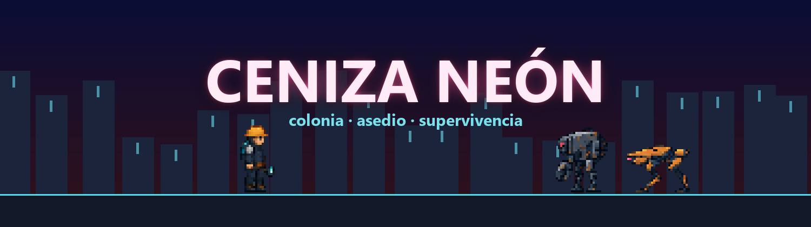
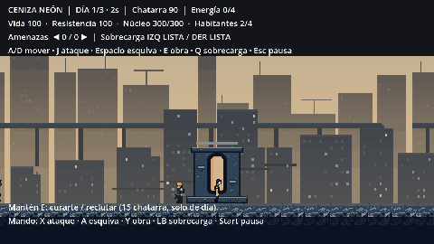
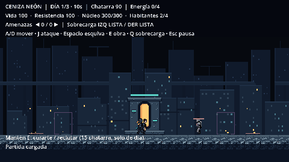
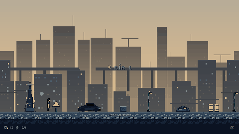
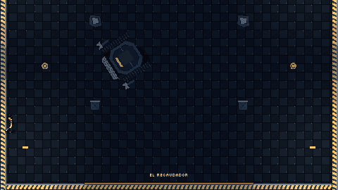
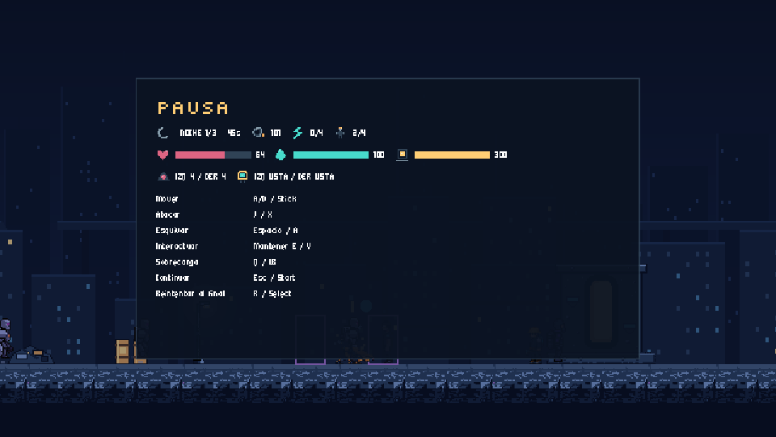

<p align="center">
  
</p>

<p align="center">
  <b>Construye de día. Resiste de noche. Recupera la ciudad.</b><br>
  Supervivencia, construcción y acción táctica en 2D con pixel art industrial cyberpunk.
</p>

<p align="center">
  
  
  
  
  
</p>

<p align="center">
  <a href="#el-juego">El juego</a> ·
  <a href="#características">Características</a> ·
  <a href="#cómo-jugar">Cómo jugar</a> ·
  <a href="#controles">Controles</a> ·
  <a href="#hoja-de-ruta">Hoja de ruta</a> ·
  <a href="#desarrollo">Desarrollo</a> ·
  <a href="#créditos-y-licencias">Créditos</a>
</p>

---

## El juego

Estado actual: [guía para jugar](INICIO.md), [cinco capítulos, operaciones y final](docs/HISTORIA_Y_CAMPANA.md). En la colonia el Portador dirige y sus tropas combaten; J funciona en arenas. Las cuatro horas siguen siendo una meta pendiente de ampliar y medir.

El núcleo, murallas y torretas tienen tres niveles con diseños de PixelLab y desbloqueos. Se normalizó la escala respecto al Portador y se añadió transporte eléctrico opcional. [Progresión, tamaños y movilidad](docs/ESCALA_NIVELES_Y_MOVILIDAD.md).

Tras un colapso tecnológico, una red autónoma de máquinas intenta borrar los últimos asentamientos humanos. Eres el **Portador**, la persona que lleva una llave neuronal capaz de reactivar la infraestructura antigua. De día recuperas chatarra, reclutas supervivientes y levantas defensas; de noche las máquinas vuelven a conectarse y atacan la colonia por ambos lados.

Para liberar un distrito destruyes sus **repetidores enemigos**, tomas el **tren blindado** y enfrentas al jefe que protege el enlace de transporte en una arena con vista cenital.

La ruta jugable conecta **Periferia oxidada → Fundición → Barrio inundado → Ciudadela corporativa → Núcleo de la red** y cinco jefes distintos. Viajas conservando mejoras y habitantes; cada colonia tiene tres operaciones de historia y sus propios frentes. [Ruta, jefes y pruebas directas](docs/HISTORIA_Y_CAMPANA.md).

La revisión actual sigue el GDD: **campamentos → herramientas → profesiones**, construcción con trabajadores, murallas por etapas y **experiencia recogible con tres elecciones al subir de nivel**. [Revisión a fondo, referencias y pendientes](docs/REVISION_GDD_KINGDOM_SURVIVORS.md).

> *"De día, la ciudad parecía muerta. De noche, las máquinas vuelven a conectarse."*

Inspiraciones: **Kingdom Two Crowns** (defensa lateral, economía y expansión), **Dark Souls** (resistencia, esquiva y jefes legibles), **Enter the Gungeon** (arenas de jefe) y **Vampire Survivors** (armamento automático, en desarrollo).

<p align="center">
  <br>
  <sub>Ciclo de luz: día con calima, atardecer de aviso y noche de asedio.</sub>
</p>

## Características

<table>
  <tr>
    <td width="50%">
      <br>
      <b>Defensa viva.</b> Las obras se levantan por etapas, se agrietan, echan humo y se rompen en pedazos reales del sprite. Sin barras de vida: el estado se lee mirando el juego.
    </td>
    <td width="50%">
      <br>
      <b>Repetidores y tren.</b> Destruye las dos antenas enemigas de los extremos del distrito y el tren blindado llega a la estación.
    </td>
  </tr>
  <tr>
    <td width="50%">
      <br>
      <b>El Recaudador.</b> Primer jefe, en arena cenital: escudo frontal, abanicos de fichas, garrazo y una embestida que, si choca, deja su núcleo expuesto. Segunda fase al 50 %.
    </td>
    <td width="50%">
      <br>
      <b>HUD mínimo.</b> Recursos en una esquina, viñeta roja al recibir daño, flechas de amenaza en los bordes y todo el detalle solo al pausar.
    </td>
  </tr>
</table>

- **Combate exigente:** ataque cuerpo a cuerpo, esquiva con invulnerabilidad y resistencia; el cansancio se nota en la animación.
- **Siete tipos de enemigo:** Errante, Corredor, Blindado, Saltador, Ariete, Artillero con proyectiles interceptables y Saboteador que busca instalaciones.
- **Colonias ampliadas:** mapas de 3200 unidades, suministros, generadores, recicladoras, cuarteles y puestos médicos. Profesiones, escuadras y expansión por murallas. [Reglas actuales y escena de práctica](docs/REVISION_GDD_KINGDOM_SURVIVORS.md).
- **Siluetas propias:** Blindado, Saltador y Ariete usan piezas mecánicas animadas con armadura, muelles y pistón; conservan los sprites anteriores como alternativa del Inspector.
- **Defensas articuladas:** las torretas siguen blancos y disparan con retroceso desde el cañón. Introducción sin consumir tiempo, objetivos visibles y viajes entre colonias con guardado.
- **Colonia con profesiones:** recluta supervivientes y ofrece herramientas a trabajadores, tiradores, guardianes, técnicos y médicos. Refugios amplían la población hasta veinte.
- **Economía y energía:** chatarra para construir, capacidad energética para mantener torretas y sobrecarga independiente por frente.
- **Expediciones:** la colonia se pausa mientras luchas contra el jefe; si caes, vuelves al mismo momento para prepararte mejor.
- **Guardado automático** al comenzar cada día (incluye repetidores destruidos y el tren).
- **Experiencia y clínica:** recoge datos, sube de nivel y elige una mejora. La clínica permite configurar equipo y cambiar cuatro pasivas entre seis disponibles, conservando las evoluciones.
- **Equipo automático:** dos ranuras, dron, Tesla y disco orbital; cinco niveles, pasivas y tres evoluciones mediante núcleos de enlace. [Cómo equiparlos y evolucionarlos](docs/MODULOS_Y_EVOLUCIONES.md).
- **Audio por fases:** música original de trabajo por capas y efectos CC0 de combate. M silencia el audio; mezcla separada de música y efectos.
- **Arte pixel coherente:** todo en vista lateral plana (la arena es cenital), paleta propia, fuentes pixel y fondo con parallax.

## Cómo jugar

### Requisitos

| | |
|---|---|
| Motor | [Godot 4.7.2](https://godotengine.org/download), edición estándar (no requiere .NET) |
| Sistema | Windows (otros sistemas sin probar) |
| Controles | Teclado o mando (Xbox / PlayStation) |
| Dependencias | Ninguna |

### Instalación

```bash
git clone https://github.com/chefsitturchey-web/Ceniza-ne-n.git
```

1. Abre Godot y pulsa **Importar**; elige `project.godot` dentro de la carpeta.
2. Espera la importación inicial (la primera vez importa fuentes, sprites y audio).
3. Pulsa **F5**, elige **Nueva partida** o **Continuar**. Una nueva colonia muestra la explicación con el reloj detenido; pulsa **Comenzar**. **Opciones** permite ajustar audio, ventana y efectos; también está en la pausa de colonia y jefe.

También puedes usar **Code → Download ZIP**. Este repositorio no incluye ejecutable: el juego se prueba desde el editor.

### Primera partida

1. **Construye ambos frentes.** Acércate a los marcos de obra y mantén **E**. Empiezas con 90 de chatarra.
2. **Deja trabajar a la colonia.** El constructor levanta las obras y el recuperador trae chatarra durante el día.
3. **Recluta** en el núcleo central (15 de chatarra por habitante, hasta cuatro).
4. **Resiste la noche.** Las flechas rosas en los bordes indican por dónde vienen. Usa **Q** para sobrecargar el frente donde estás.
5. **Abre el camino.** Destruye los repetidores de ambos extremos; cuando llegue el tren, de día, mantén **E** en la estación para viajar al jefe.

La guía detallada de esta versión está en [INICIO.md](INICIO.md).

## Controles

| Acción | Teclado | Mando |
|---|---|---|
| Moverse | A / D (W / S en la arena) | Stick izquierdo / cruceta |
| Atacar en arenas de jefe | J | X / Cuadrado |
| Esquivar | Espacio | A / Cruz |
| Construir, reparar, reclutar, viajar | Mantener E | Mantener Y / Triángulo |
| Sobrecarga del frente | Q | LB / L1 |
| Pausa y estadísticas | Esc | Start |
| Nueva partida tras el final | R | Select |
| Silenciar audio | M | — |

## Hoja de ruta

| Hecho | En curso | Próximo |
|---|---|---|
| Tres distritos conectados, Clínica y equipo persistente | Producción musical final; audio de trabajo integrado | Pruebas de equilibrio con jugadores |
| Recaudador, Santa Caldera y Coro Sumergido; módulos, pasivas y evoluciones | Arte definitivo del Corredor y Constructor | Distritos y jefes restantes del GDD |
| Errante, Corredor, Blindado, Saltador y Ariete | Nuevo Corredor y Constructor con el estilo actual | Saboteador, Dron cazador, Artillero, Portador y Reparador |
| Efectos, ciclo de luz, menús, animaciones y opciones | Pulido y variedad de encuentros | Más eventos y objetivos por distrito |

El alcance completo está en el [documento de diseño (GDD)](CENIZA_NEON_GDD.docx).

## Desarrollo

### Estructura

```text
core/        Controles y reglas compartidas
components/  Vida, golpes, efectos y escombros reutilizables
entities/    Jugador, enemigos, jefe, trabajadores y estructuras
systems/     Ciclo, economía, obras, colonia, asedio, defensas, guardado y expediciones
ui/          HUD, panel de pausa, tema y fuentes
data/        Recursos .tres de enemigos, estructuras, oleadas y ciclos
levels/      Distrito principal y arena del jefe
assets/      Sprites, fondos, íconos y fuentes
tools/       Scripts para generar e integrar arte
tests/       Pruebas automatizadas y simulaciones
docs/        Arquitectura, guía de arte, registro de recursos y medios del README
```

### Pruebas

```bash
godot --headless --path . --import
godot --headless --path . --script res://tests/run_all.gd
```

`run_all.gd` ejecuta 32 casos, incluyendo expansión/unidades, campaña y jefes, menú/opciones, animación/pulido, módulos/evoluciones, siluetas, combate, guardado, expedición y simulaciones desde una colonia nueva en las cinco zonas. Termina con error ante cualquier fallo detectado. El aviso de referencias al cerrar el comprobador estático y los límites del ejecutor se detallan en [menú y opciones](docs/MENU_Y_OPCIONES.md). En Windows sustituye `godot` por la ruta del ejecutable de consola.

### Flujo de trabajo

- Cada tarea va en su propia rama (`feature/...`, `audio/...`, `ui/...`) y entra en `main` con Pull Request cuando las pruebas pasan sin fallos.
- El tablero de sprints y tareas está en Notion (acceso por invitación).
- Arte: personajes animados con PixelLab; estructuras, decoración y piezas del jefe con Stable Diffusion local a partir de bocetos planos (`tools/`). Todo recurso externo se registra en [docs/ASSET_SOURCES.csv](docs/ASSET_SOURCES.csv).

### Documentación

- [Arquitectura y señales](docs/ARQUITECTURA.md)
- [Guía de arte y paleta](docs/GUIA_ARTE.md)
- [Guía de la versión actual](INICIO.md)
- [Revisión, mejoras neuronales, audio y recursos pendientes](docs/REVISION_Y_AUDIO.md)
- [Menú ilustrado y opciones persistentes](docs/MENU_Y_OPCIONES.md)
- [Equipo y evoluciones](docs/MODULOS_Y_EVOLUCIONES.md)
- [Siluetas mecánicas y presentación de enemigos](docs/SILUETAS_MECANICAS.md)
- [Pulido jugable, torretas articuladas y animación de arena](docs/PULIDO_JUGABLE.md)
- [Documento de diseño (GDD)](CENIZA_NEON_GDD.docx)

### Añadir contenido

- **Enemigo:** duplica una escena de `entities/enemies/`, crea su `EnemyData` en `data/enemies/` y añádelo a una oleada de `data/waves/`. El director de asedio no necesita cambios de código.
- **Estructura:** duplica un `StructureData` de `data/structures/`, asígnale textura y añádelo a `Construction.blueprints` en `levels/main.tscn`.

## Equipo

| | |
|---|---|
| **Carlos Alberto Llano Flores — Turchey** | Dirección, diseño y programación |
| **Timoteo** | Música, efectos de sonido y menús |

Con apoyo de asistentes de IA (Claude y Codex) para programación, herramientas y arte, siempre revisado por el equipo.

## Créditos y licencias

- **Motor:** [Godot Engine](https://godotengine.org) (licencia MIT).
- **Sonidos:** Kenney, Sci-fi Sounds 1.0, CC0; licencia incluida en `assets/audio/sfx/`. Música sintética original de trabajo, reproducible con `tools/generar_musica.py`.
- **Fuentes:** Micro 5 y Silkscreen, bajo [SIL Open Font License](assets/fonts/) (licencias incluidas).
- **Arte generado:** PixelLab (según sus [términos de servicio](https://pixellab.ai/termsofservice)) y Stable Diffusion 1.5 (CreativeML OpenRAIL-M) con un LoRA de pixel art. Detalle por recurso en [docs/ASSET_SOURCES.csv](docs/ASSET_SOURCES.csv).

El código y el contenido original de Ceniza Neón son de su autor; **todos los derechos reservados** mientras no se publique una licencia. ¿Encontraste un problema o tienes una idea? Abre un [issue](https://github.com/chefsitturchey-web/Ceniza-ne-n/issues) indicando qué esperabas, qué ocurrió y cómo reproducirlo.
