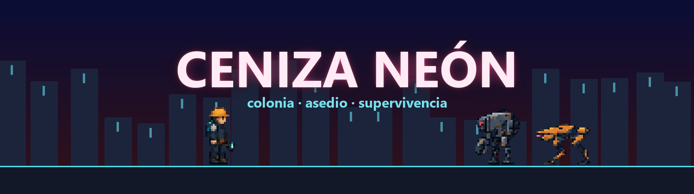
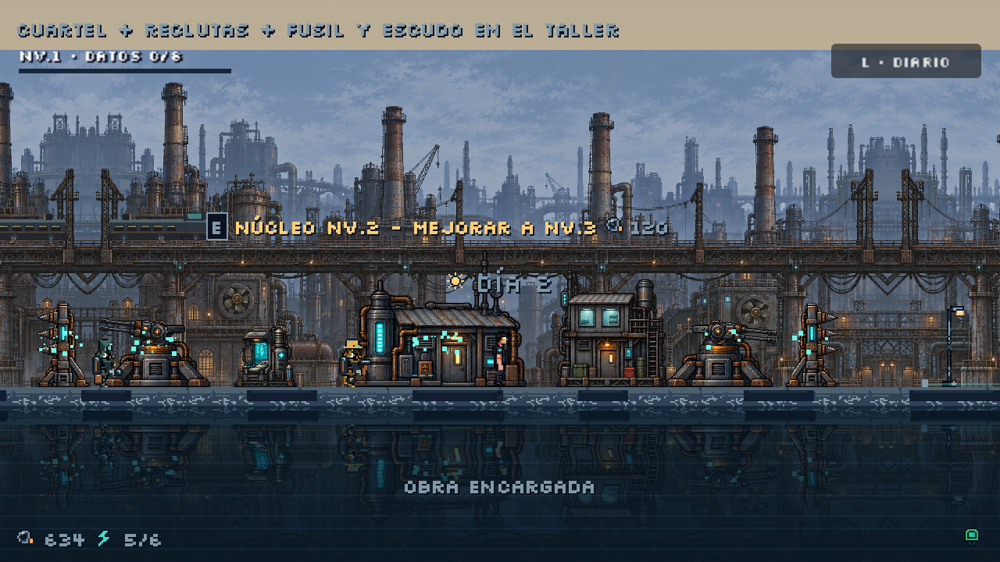

<p align="center"></p>

# CENIZA NEÓN

Construye de día, resiste de noche y recupera cinco distritos. Proyecto de Godot 4.7.2, versión `0.1.0-alpha`; `project.godot` abre `ui/main_menu.tscn`. La colonia es lateral y los jefes se combaten en arenas cenitales.

## Jugar

Importa `project.godot`, espera la importación y pulsa **F5**. El menú ofrece **Nueva partida**, **Continuar**, **Boss Rush** y **Opciones**. [Guía de inicio](INICIO.md) · [Índice de documentación](docs/README.md) · [Exportación](docs/EXPORTAR.md).

La campaña conecta Periferia, Fundición, Barrio inundado, Ciudadela y Núcleo de la red. Empiezas con un constructor, un recuperador y el núcleo por construir. Recupera piezas, encarga obras, recluta habitantes y compra herramientas para sus profesiones. Las tropas y torretas defienden la colonia; el Portador combate personalmente en los jefes. Completa rescate, relé y convoy, cierra las entradas y estabiliza la colonia para tomar el tren.



## Funciones implementadas

- **Boss Rush:** encadena los cinco jefes sin novela visual. Entre victorias recuperas hasta la mitad de la vida máxima y el filo mejora. Registra los diez mejores tiempos con nombre y golpes en `user://boss_rush.cfg`; los resultados muestran los cinco primeros. [Reglas y prueba](docs/gameplay/BOSS_RUSH.md).
- **Historia automática:** 40 escenas de novela visual, incluidas entrada y victoria de los cinco jefes. Las escenas vistas se registran y el diario permite releerlas; Boss Rush excluye la narración. [Disparadores y guardado](docs/gameplay/HISTORIA_FLUJO.md).
- **Pistas y cuerpo a cuerpo:** avisos cortos por combate, teclas según dispositivo y reasignación; combos, golpes de área, empujones y acometidas con anticipación. [Tácticas](docs/gameplay/JEFES_TACTICAS_Y_ARENAS.md).
- **Guía con flecha:** once pasos y consejos contextuales. Nueva partida reinicia los pasos y consejos; conserva logros y récord del perfil. [Primeros pasos y rondas](docs/gameplay/PRIMEROS_PASOS_Y_RONDAS.md).
- **Frontera:** mapas de 14.400 píxeles con variación por semilla, núcleo desde cero, despejes, mochila de 24 piezas y depósito. Poblados recuperables aportan construcción, daño o curación. [Frontera](docs/gameplay/FRONTERA_Y_RECONSTRUCCION.md) · [Poblados](docs/gameplay/POBLADOS_Y_TECNOLOGIA.md).
- **Trabajo nocturno con riesgo:** aceptar una orden de noche autoriza la salida de trabajadores hasta el amanecer; pueden recibir ataques y morir. [Reglas](docs/gameplay/TRABAJO_NOCTURNO.md).
- **Equipo:** experiencia recogible, elecciones al subir de nivel, tres módulos, seis pasivas y evoluciones. [Equipo](docs/gameplay/MODULOS_Y_EVOLUCIONES.md).
- **Interfaz:** pausa con controles, opciones de teclado/mando/táctil y resaltado de teclas mediante `TextMarks`. [Menús y opciones](docs/interface/MENU_Y_OPCIONES.md).
- **Presentación:** fondos animados por máscaras y shader, retratos y animaciones editables de LibreSprite. Música OGG y efectos de 8 bits, incluidos sonidos de diálogo por personaje. [Fondos](docs/art/FONDOS_EN_CAPAS.md) · [Arte](docs/art/ARTE_COMBATE_ILUSTRADO.md) · [Audio](docs/audio/AUDIO.md).
- **Práctica:** laboratorio F1 en editor/depuración y galerías F6. [Laboratorio](docs/interface/LABORATORIO_DEPURACION.md).

## Controles predeterminados

| Acción | Teclado | Mando (nombres Xbox) |
| --- | --- | --- |
| Mover | A/D, flechas; W/S en arena | Stick / cruceta |
| Correr | Shift | Cruceta abajo |
| Construir / operar | Mantener E | Mantener Y |
| Asaltar / retirar | F | Cruceta arriba |
| Atacar en arena | J | X |
| Esquivar | Espacio | A |
| Sobrecarga | Q | LB |
| Alimentación de torreta | T | B |
| Plataforma | V | Pulsar stick izquierdo |
| Diario | L | RB |
| Pausa | Esc | Start |

**M** silencia. Opciones permite reasignar la tecla y el botón principales de las acciones. Los avisos siguen el dispositivo y los controles configurados; la pausa permite consultarlos.

## Desarrollo y comprobación

```powershell
powershell -File tools\maintenance\validate.ps1 -GodotPath "D:\descargas\Godot_v4.7.2-stable_win64.exe\Godot_v4.7.2-stable_win64_console.exe"
```

`tests/run_all.gd` registra **67 ejecuciones de suites**, incluidas variantes con argumentos. El validador importa el proyecto, aísla `APPDATA` y centraliza registros y `summary.json` en `build/validation/latest/`. El resultado se consulta allí; la existencia de las pruebas no demuestra una duración de campaña ni una revisión visual completa.

[Arquitectura](docs/development/ARQUITECTURA.md) · [Organización](docs/ORGANIZACION.md) · [Recursos](assets/README.md) · [Herramientas](tools/README.md).

## Alcance y créditos

La ruta y el final están implementados. No hay una duración de cuatro horas medida ni decisiones narrativas ramificadas. El GDD se conserva como referencia de diseño; las guías describen lo que ejecuta el código.

La procedencia del arte se registra en [ASSET_SOURCES.csv](docs/art/ASSET_SOURCES.csv); las licencias de fuentes y audio se conservan junto a los recursos en `assets/`.

Se conservan los créditos del proyecto: **Carlos Alberto Llano Flores — Turchey**, dirección, diseño y programación; **Timoteo**, música, efectos de sonido y menús. Con apoyo de Claude y Codex para programación, herramientas y arte.

El código y el contenido original son de su autor; todos los derechos reservados mientras no se publique una licencia. Las licencias de recursos de terceros se consultan por separado junto a cada recurso.
