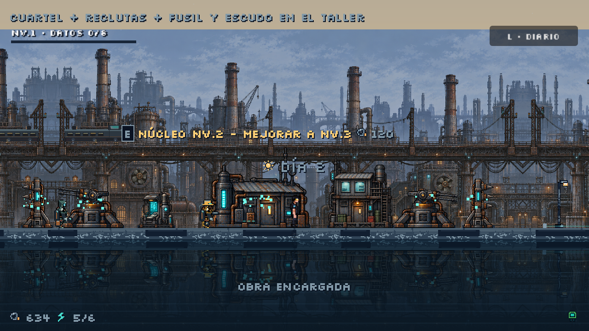
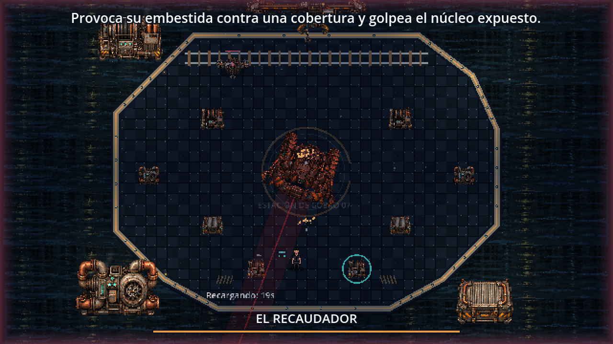
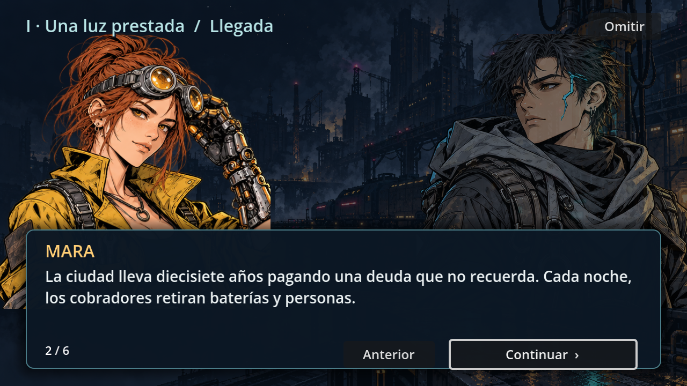
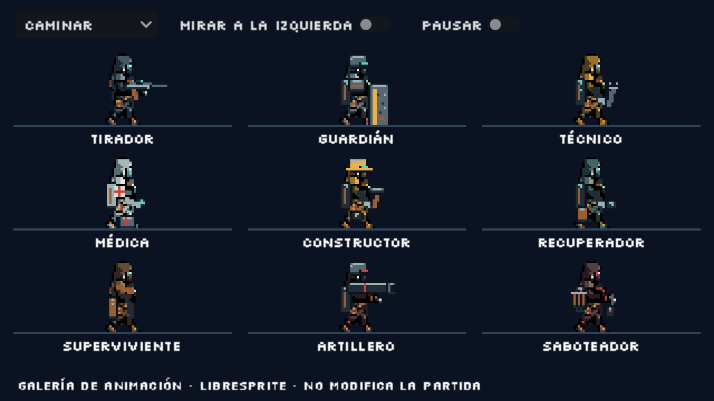

<p align="center">
  
</p>

<p align="center">
  <b>Construye de día. Resiste de noche. Recupera la ciudad.</b><br>
  Supervivencia, construcción y acción táctica en 2D con pixel art industrial cyberpunk.
</p>

<p align="center">
  
  
  
  
  
</p>

<p align="center">
  <a href="#el-juego">El juego</a> ·
  <a href="#características">Características</a> ·
  <a href="#cómo-jugar">Cómo jugar</a> ·
  <a href="#controles">Controles</a> ·
  <a href="#hoja-de-ruta">Hoja de ruta</a> ·
  <a href="#desarrollo">Desarrollo</a> ·
  <a href="#créditos-y-licencias">Créditos</a>
</p>

---

## El juego

Estado actual: [guía para jugar](INICIO.md), [cinco capítulos, operaciones y final](docs/design/HISTORIA_Y_CAMPANA.md). En la colonia el Portador dirige y sus tropas combaten; J funciona en arenas. Las cuatro horas siguen siendo una meta pendiente de ampliar y medir.

**Laboratorio con F1:** acceso directo a los cinco jefes, fases, equipo, invulnerabilidad, cámara lenta, colisiones/rutas y creación de unidades. Permite volver a la escena original; las intervenciones de colonia quedan como práctica sin sobrescribir el checkpoint. [Controles y guía](docs/interface/LABORATORIO_DEPURACION.md).

**Combates con más presión:** robots un 30 % mayores, barridos de mayor alcance, ataques secundarios simultáneos, erupciones, ondas de sonar y cortes eléctricos. Los impactos tienen escombros, humo y temblor breve; las ventanas de núcleo expuesto cancelan las trampas pendientes. La marcha del Portador, Prefecto y Madre utiliza ocho fases articuladas en LibreSprite, conservando el dibujo aprobado. [Cambios y cómo probarlos](docs/gameplay/EFECTOS_Y_PRESION_JEFES.md).

**Interfaz de arenas:** vida numérica y barra roja del Portador, resistencia verde y barra inferior de jefe con estela del daño, marco y emblema propios de cada zona. [Diseño y pruebas](docs/interface/INTERFAZ_COMBATE.md).

**Arte de combate ilustrado:** el Portador y los cinco jefes recuperan sus diseños manga con poses de marcha, estocada, reacción y caída; el Portador tiene además volteretas propias en ambas cámaras. La base se generó con `image_gen` y se registró, ajustó y exportó en LibreSprite. Son 416 poses de entrada y 1792 fotogramas de línea de tiempo con pausas y reutilización. La galería F6 incluye **Giro**, detalle con **1–6** y conjunto con **0**. [Diseños, tamaños, prompts y fuentes editables](docs/art/ARTE_COMBATE_ILUSTRADO.md).

El núcleo, murallas y torretas tienen tres niveles, diseños industriales coherentes y desbloqueos. Se normalizó la escala respecto al Portador y se añadió transporte eléctrico opcional. [Progresión, tamaños y movilidad](docs/gameplay/ESCALA_NIVELES_Y_MOVILIDAD.md).

La historia incluye **30 conversaciones de novela visual**, ocho retratos manga a color, transiciones y repetición desde el diario. Las profesiones aliadas, civiles, Artillero y Saboteador tienen **nueve variantes con 72 fotogramas cada una**, con archivos editables de LibreSprite.

<p align="center">
  <br>
  <sub>Núcleo, edificios y defensas con materiales comunes y apoyo al suelo.</sub>
</p>

Tras un colapso tecnológico, una red autónoma de máquinas intenta borrar los últimos asentamientos humanos. Eres el **Portador**, la persona que lleva una llave neuronal capaz de reactivar la infraestructura antigua. De día recuperas chatarra, reclutas supervivientes y levantas defensas; de noche las máquinas vuelven a conectarse y atacan la colonia por ambos lados.

Para liberar un distrito destruyes sus **repetidores enemigos**, tomas el **tren blindado** y enfrentas al jefe que protege el enlace de transporte en una arena con vista cenital.

La ruta jugable conecta **Periferia oxidada → Fundición → Barrio inundado → Ciudadela corporativa → Núcleo de la red** y cinco jefes distintos. Viajas conservando mejoras y habitantes; cada colonia tiene tres operaciones de historia y sus propios frentes. [Ruta, jefes y pruebas directas](docs/design/HISTORIA_Y_CAMPANA.md).

Los **cinco jefes** reaccionan a distancia, trayectoria, coberturas o infraestructura mediante decisiones locales y navegación A*. Las arenas incorporan carga suspendida, refrigeración, corriente y sonar, parapeto temporal y sabotaje de relés; hay artilleros, cazadores y saboteadores con llegada anunciada y límites simultáneos. Maquinaria propia por distrito, relés detallados y avisos más legibles. [Tácticas, mecanismos y escenas para probar con F6](docs/gameplay/JEFES_TACTICAS_Y_ARENAS.md).

La revisión actual sigue el GDD: **campamentos → herramientas → profesiones**, construcción con trabajadores, murallas por etapas y **experiencia recogible con tres elecciones al subir de nivel**. [Revisión a fondo, referencias y pendientes](docs/design/REVISION_GDD_KINGDOM_SURVIVORS.md).

> *"De día, la ciudad parecía muerta. De noche, las máquinas vuelven a conectarse."*

Inspiraciones: **Kingdom Two Crowns** (defensa lateral, economía y expansión), **Dark Souls** (resistencia, esquiva y jefes legibles), **Enter the Gungeon** (arenas de jefe) y **Vampire Survivors** (experiencia, elección de armas y pasivas, equipo automático y evoluciones).

<p align="center">
  <br>
  <sub>Ciclo de luz: día con calima, atardecer de aviso y noche de asedio.</sub>
</p>

## Características

<table>
  <tr>
    <td width="50%">
      <br>
      <b>Defensa viva.</b> Las obras se levantan por etapas, se agrietan, echan humo y se rompen en pedazos reales del sprite. Sin barras de vida: el estado se lee mirando el juego.
    </td>
    <td width="50%">
      <br>
      <b>Portales y tren.</b> Ordena asaltos con tus tropas, cierra las entradas y completa las operaciones. Estabiliza la colonia para viajar al jefe.
    </td>
  </tr>
  <tr>
    <td width="50%">
      <br>
      <b>El Recaudador.</b> Primer jefe, en arena cenital: escudo frontal, abanicos de fichas, garrazo y una embestida que, si choca, deja su núcleo expuesto. Segunda fase al 50 %.
    </td>
    <td width="50%">
      <br>
      <b>HUD mínimo.</b> Recursos en una esquina, viñeta roja al recibir daño, flechas de amenaza en los bordes y todo el detalle solo al pausar.
    </td>
  </tr>
  <tr>
    <td width="50%">
      <br>
      <b>Historia ilustrada.</b> Conversaciones durante la campaña, retratos manga a color, texto legible, fundidos y diario para releer.
    </td>
    <td width="50%">
      <br>
      <b>Personajes animados.</b> Marcha, trabajo, transporte de carga, daño, cansancio, caída e incorporación, con equipo por profesión y fuentes de LibreSprite.
    </td>
  </tr>
</table>

- **Dos papeles para el Portador:** dirige tropas y construcciones en la colonia; combate personalmente en las arenas con esquiva, resistencia y equipo automático.
- **Siete tipos de enemigo:** Errante, Corredor, Blindado, Saltador, Ariete, Artillero con proyectiles interceptables y Saboteador que busca instalaciones.
- **Colonias ampliadas:** mapas de 3200 unidades, suministros, generadores, recicladoras, cuarteles y puestos médicos. Profesiones, escuadras y expansión por murallas. [Reglas actuales y escena de práctica](docs/design/REVISION_GDD_KINGDOM_SURVIVORS.md).
- **Siluetas propias:** Blindado, Saltador y Ariete usan piezas mecánicas animadas con armadura, muelles y pistón; conservan los sprites anteriores como alternativa del Inspector.
- **Defensas articuladas:** las torretas siguen blancos y disparan con retroceso desde el cañón. Introducción sin consumir tiempo, objetivos visibles y viajes entre colonias con guardado.
- **Colonia con profesiones:** recluta supervivientes y ofrece herramientas a trabajadores, tiradores, guardianes, técnicos y médicos. Refugios amplían la población hasta veinte.
- **Economía y energía:** chatarra para construir, capacidad energética para mantener torretas y sobrecarga independiente por frente.
- **Expediciones:** la colonia se pausa mientras luchas contra el jefe; si caes, vuelves al mismo momento para prepararte mejor.
- **Guardado automático** al comenzar cada día (incluye repetidores destruidos y el tren).
- **Experiencia y clínica:** recoge datos, sube de nivel y elige una mejora. La clínica permite configurar equipo y cambiar cuatro pasivas entre seis disponibles, conservando las evoluciones.
- **Equipo automático:** dos ranuras, dron, Tesla y disco orbital; cinco niveles, pasivas y tres evoluciones mediante núcleos de enlace. [Cómo equiparlos y evolucionarlos](docs/gameplay/MODULOS_Y_EVOLUCIONES.md).
- **Audio por fases:** música original de trabajo por capas y efectos CC0 de combate. M silencia el audio; mezcla separada de música y efectos.
- **Presentación:** pixel art lateral en la colonia, arenas cenitales, agua con reflejos, parallax y novela visual con ilustraciones manga a color.
- **Distrito vivo:** chimeneas con humo, trenes y extractores en el fondo; el primer jefe protege un depósito poligonal junto al canal, con grúa, bombas y maquinaria animada. [Taller, pasos y depósito](docs/gameplay/DEPOSITO_Y_VIDA_DEL_DISTRITO.md).

## Cómo jugar

### Requisitos

| | |
|---|---|
| Motor | [Godot 4.7.2](https://godotengine.org/download), edición estándar (no requiere .NET) |
| Sistema | Windows (otros sistemas sin probar) |
| Controles | Teclado o mando (Xbox / PlayStation) |
| Dependencias | Ninguna |

### Instalación

```bash
git clone https://github.com/chefsitturchey-web/Ceniza-ne-n.git
```

1. Abre Godot y pulsa **Importar**; elige `project.godot` dentro de la carpeta.
2. Espera la importación inicial (la primera vez importa fuentes, sprites y audio).
3. Pulsa **F5**, elige **Nueva partida** o **Continuar**. Una nueva colonia muestra la explicación con el reloj detenido; pulsa **Comenzar**. **Opciones** permite ajustar audio, ventana y efectos; también está en la pausa de colonia y jefe.

También puedes usar **Code → Download ZIP**. Este repositorio no incluye ejecutable: el juego se prueba desde el editor.

### Primera partida

1. **Construye ambos frentes.** Acércate a los marcos de obra y mantén **E**. Empiezas con 90 de chatarra.
2. **Deja trabajar a la colonia.** El constructor levanta las obras y el recuperador trae chatarra durante el día.
3. **Amplía y recluta.** Construye un generador, mejora el núcleo a nivel 2 y levanta un cuartel. Recluta en los campamentos y compra herramientas en el taller para asignar profesiones.
4. **Resiste la noche.** Las flechas rosas en los bordes indican por dónde vienen. Usa **Q** para sobrecargar el frente donde estás.
5. **Abre el camino.** Usa **F** para ordenar asaltos a los portales; otra F retira las tropas. Completa rescate, relé y escolta, cierra las entradas y estabiliza la colonia. Cuando llegue el tren, mantén **E** en la estación durante el día.

La guía detallada de esta versión está en [INICIO.md](INICIO.md).

## Controles

| Acción | Teclado | Mando |
|---|---|---|
| Moverse | A / D (W / S en la arena) | Stick izquierdo / cruceta |
| Atacar en arenas de jefe | J | X / Cuadrado |
| Esquivar | Espacio | A / Cruz |
| Construir, reparar, reclutar, viajar | Mantener E | Mantener Y / Triángulo |
| Sobrecarga del frente | Q | LB / L1 |
| Asaltar el frente / retirar tropas | F | Cruceta arriba |
| Alimentación de torreta cercana | T | B / Círculo |
| Subir / bajar de la plataforma | V | Pulsar stick izquierdo |
| Diario y objetivo | L | RB / R1 |
| Avanzar conversación | E / Enter / Espacio / clic | Y / Triángulo o aceptar |
| Pausa y estadísticas | Esc | Start |
| Nueva partida tras el final | R | Select |
| Silenciar audio | M | — |

## Hoja de ruta

| Hecho | En curso | Próximo |
|---|---|---|
| Cinco distritos, quince operaciones y final; diario y 30 conversaciones ilustradas | Medición de duración y variedad de campaña | Operaciones exclusivas, eventos y decisiones con consecuencias |
| Recaudador, Santa Caldera, Coro, Prefecto y MADRE CERO | Equilibrio y pruebas con jugadores | Más encuentros y expediciones opcionales |
| Núcleo y defensas por niveles; campamentos, herramientas, profesiones y transporte | Pulido de economía y legibilidad | Mapas por semilla y más opciones del GDD |
| Siete tipos de enemigo; nueve variantes animadas con fuentes de LibreSprite | Ampliación del catálogo y revisión artística | Enemigos y equipo restantes del GDD |
| Experiencia, armas, pasivas y evoluciones; menús, guardado y accesibilidad | Producción musical final; audio de trabajo integrado | Remapeo completo de controles y perfiles iniciales |

El alcance completo está en el [documento de diseño (GDD)](docs/design/CENIZA_NEON_GDD.docx).

## Desarrollo

### Estructura

```text
core/        Controles y reglas compartidas
components/  Vida, golpes, efectos y escombros reutilizables
entities/    Jugador, enemigos, jefe, trabajadores y estructuras
systems/     Ciclo, economía, obras, colonia, asedio, defensas, guardado y expediciones
ui/          HUD, panel de pausa, tema y fuentes
data/        Recursos .tres de enemigos, estructuras, oleadas y ciclos
levels/      Cinco distritos, arenas de jefe y galerías de práctica
assets/      Sprites, fuentes de LibreSprite, retratos, fondos, iconos y audio
tools/art/   Montaje de los sprites actuales y fuentes editables de LibreSprite
tools/audio/ Preparación y conversión de los recursos de audio actuales
tools/integrations/ Adaptadores de servicios externos
tools/maintenance/ Validación y limpieza reproducibles
tests/       Pruebas automatizadas y simulaciones
docs/        Índice de guías; GDD en design/, referencias en references/
build/       Salidas locales regenerables; no se publica en Git
```

[Dónde están los sprites y sonidos](assets/README.md) · [Índice de documentación](docs/README.md). Los personajes actuales se concentran en `assets/characters/` y los escenarios en `assets/world/`. Las copias externas de ramas `Ceniza-*` ya integradas se retiraron; este es el directorio de trabajo del juego.

### Pruebas

```bash
godot --headless --path . --editor --import --quit
godot --headless --path . --script res://tests/run_all.gd
```

`run_all.gd` ejecuta **40 suites**, incluyendo tácticas de los cinco jefes, personajes, novela visual, fortificaciones, movilidad, campaña, menús, módulos, combate, guardado y simulaciones desde cero en las cinco zonas. La última ejecución completa terminó con **0 fallos**. Termina con error ante fallos, errores de script o advertencias. En Windows sustituye `godot` por la ruta del ejecutable de consola y usa un perfil de pruebas separado de tu partida.

En Windows, el comando recomendado importa el proyecto, usa un perfil aislado y guarda todos los registros en `build/validation/latest/`:

```powershell
.\tools\maintenance\validate.ps1 -GodotPath "RUTA\Godot_console.exe"
```

`summary.json` resume los resultados y `suites/` contiene un registro por prueba y variante; se reutilizan los nombres en cada ejecución. Para borrar registros antiguos y cachés de Python: `./tools/maintenance/clean_generated.ps1`. Añade `-Validation` para borrar también las salidas y perfiles de pruebas de `build/validation/`. [Mapa del proyecto y limpieza](docs/ORGANIZACION.md), [índice de documentación](docs/README.md).

Para una revisión visual rápida, abre una escena y pulsa **F6**:

| Escena | Qué revisar |
|---|---|
| `levels/story/unit_animation_preview.tscn` | Nueve variantes, estados, dirección y pausa de animación |
| `levels/story/novel_preview.tscn` | Las 30 conversaciones ilustradas |
| `levels/zones/fortress_playground.tscn` | Construcciones, niveles y transporte con presupuesto de práctica |

Las fuentes editables están en `assets/characters/units/sources/`. [Edición y reconstrucción sin conexión](docs/art/PERSONAJES_Y_ANIMACIONES.md).

### Flujo de trabajo

- Cada tarea va en su propia rama (`feature/...`, `audio/...`, `ui/...`) y entra en `main` con Pull Request cuando las pruebas pasan sin fallos.
- El tablero de sprints y tareas está en Notion (acceso por invitación).
- Arte: poses con PixelLab, edición y exportación de personajes con LibreSprite, retratos manga y atlas industriales con OpenAI Image Generation; también se conservan recursos de Stable Diffusion local. Procedencia por recurso en [docs/art/ASSET_SOURCES.csv](docs/art/ASSET_SOURCES.csv).

### Documentación

- [Arquitectura y señales](docs/development/ARQUITECTURA.md)
- [Guía de arte y paleta](docs/GUIA_ARTE.md)
- [Novela visual manga y coherencia de estructuras](docs/art/NOVELA_VISUAL_Y_COHERENCIA.md)
- [Personajes animados y edición en LibreSprite](docs/art/PERSONAJES_Y_ANIMACIONES.md)
- [Recogida de herramientas, cadencia y depósito del primer jefe](docs/gameplay/DEPOSITO_Y_VIDA_DEL_DISTRITO.md)
- [Referencias visuales y capturas actuales](docs/art/REFERENCIAS_VISUALES.md)
- [Guía de la versión actual](INICIO.md)
- [Revisión, mejoras neuronales, audio y recursos pendientes](docs/audio/AUDIO.md)
- [Menú ilustrado y opciones persistentes](docs/interface/MENU_Y_OPCIONES.md)
- [Equipo y evoluciones](docs/gameplay/MODULOS_Y_EVOLUCIONES.md)
- [Siluetas mecánicas y presentación de enemigos](docs/art/SILUETAS_MECANICAS.md)
- [Pulido jugable, torretas articuladas y animación de arena](docs/gameplay/EFECTOS_Y_PRESION_JEFES.md)
- [Documento de diseño (GDD)](docs/design/CENIZA_NEON_GDD.docx)

### Añadir contenido

- **Enemigo:** duplica una escena de `entities/enemies/`, crea su `EnemyData` en `data/enemies/` y añádelo a una oleada de `data/waves/`. El director de asedio no necesita cambios de código.
- **Estructura:** duplica un `StructureData` de `data/structures/`, asígnale textura y añádelo a `Construction.blueprints` en `levels/main.tscn`.

## Equipo

| | |
|---|---|
| **Carlos Alberto Llano Flores — Turchey** | Dirección, diseño y programación |
| **Timoteo** | Música, efectos de sonido y menús |

Con apoyo de asistentes de IA (Claude y Codex) para programación, herramientas y arte, siempre revisado por el equipo.

## Créditos y licencias

- **Motor:** [Godot Engine](https://godotengine.org) (licencia MIT).
- **Sonidos:** Kenney, Sci-fi Sounds 1.0, CC0; licencia incluida en `assets/audio/sfx/`. El repertorio actual de música 8 bit se documenta en [Audio](docs/audio/AUDIO.md).
- **Fuentes:** Micro 5 y Silkscreen, bajo [SIL Open Font License](assets/fonts) (licencias incluidas).
- **Arte generado:** OpenAI Image Generation (retratos manga y nuevos atlas industriales), PixelLab (según sus [términos de servicio](https://pixellab.ai/termsofservice)) y Stable Diffusion 1.5 (CreativeML OpenRAIL-M) con un LoRA de pixel art. Detalle por recurso en [docs/art/ASSET_SOURCES.csv](docs/art/ASSET_SOURCES.csv).

El código y el contenido original de Ceniza Neón son de su autor; **todos los derechos reservados** mientras no se publique una licencia. ¿Encontraste un problema o tienes una idea? Abre un [issue](https://github.com/chefsitturchey-web/Ceniza-ne-n/issues) indicando qué esperabas, qué ocurrió y cómo reproducirlo.
