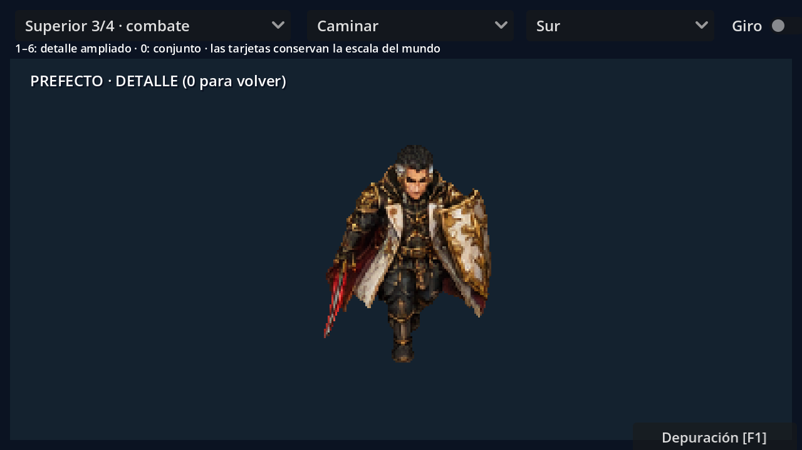
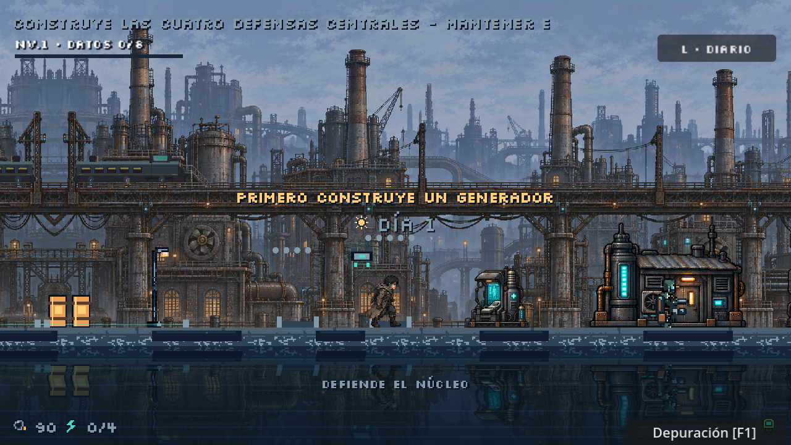

# Portador y jefes: poses ilustradas y animación

## Identidad y materiales

El Portador conserva el diseño de la esquina inferior derecha de `assets/story/portraits_manga_v2.png`: cabello negro, rostro humano visible, implante cian pequeño, bufanda oscura, abrigo marrón grisáceo gastado, correas y colgante. Sus dos versiones están dibujadas para la colonia lateral y la arena a tres cuartos.

El Prefecto recupera el rostro, cabello negro con mechón gris, implante dorado y uniforme de marfil, negro y oro de su retrato. Lleva espada en la derecha, escudo en la izquierda y capa granate. Madre Cero recupera el rostro pálido, cabello blanco, ojos rojos, vestido ceremonial y cables de su retrato. El halo permanece unido a la cabeza y acompaña el cuerpo.

Los tres autómatas tienen construcciones distintas: orugas y pinzas hidráulicas del Recaudador; caldera de cobre con chimeneas, válvulas y seis patas; chasis de sonar del Coro con cuatro patas y antenas articuladas. Las chapas, tubos, remaches, reflectores y superficies gastadas forman parte de la pintura de cada pose.





## Poses, cámaras y tamaños

Hay **siete variantes de seis personajes**, doce hojas originales seleccionadas y **416 poses de entrada**: 80 por cada versión del Portador, 64 del Prefecto y 48 de cada uno de los otros cuatro jefes. Los ASE contienen **256 fotogramas de línea de tiempo y 40 etiquetas por variante**, 1792 en total. Esos fotogramas incluyen pausas y reutilización de poses; no son 1792 dibujos independientes.

Las cuatro vistas están pintadas por separado: frente, perfil derecho, espalda y perfil izquierdo. La cabeza permanece sobre los pies al estar de pie; las volteretas usan poses encogidas y de apoyo propias. Las estocadas tienen hojas adicionales que muestran el filo hacia cada dirección, incluida la vista de espalda con la espada extendida hacia arriba.

| Variante | Lienzo nativo | Escala de dibujo | Altura aproximada de pie en mundo |
| --- | --- | --- | --- |
| Portador lateral y superior | 192 × 192 | 0,5 | 32–35 px |
| Prefecto | 320 × 320 | 0,5 | 58 px con equipo |
| Recaudador, Caldera y Coro | 320 × 320 | 0,65 | 88–92 px con equipo |
| Madre | 320 × 320 | 0,5 | 72 px con equipo |

El lienzo incluye márgenes para armas, cables, halo y poses caídas. Los anclajes de `layout.json` registran el apoyo y se aplican a la escala del dibujo. La galería respeta el tamaño de mundo; el modo de detalle amplía únicamente la previsualización. Las sombras del Prefecto y Madre tienen tamaño propio. Los fragmentos de derrota usan la escala y posición reales del sprite.

## Movimiento y ataque

La marcha de los humanoides se construye ahora sobre un único dibujo registrado por dirección: una malla de cadera, rodilla y pie produce ocho fases con apoyos alternos, elevación del pie, balanceo contrario de brazos y movimiento secundario del abrigo. No intercala reposo ni cambia de cabeza, proporciones o equipamiento entre pasos. La espada del Prefecto queda fuera de la deformación de las piernas. Las mallas se dibujan y exportan en LibreSprite; Godot reproduce los fotogramas completos.

El ciclo sigue la distancia recorrida: 64 unidades para el Portador en la colonia y 56 en la arena; 76 para el Prefecto y 92 para Madre Cero, evitando su antigua cadencia excesiva de 40 unidades. Los guardias conservan la orientación visible del escudo y revierten el paso al retroceder. Una banda de tolerancia evita cambios de vista rápidos al moverse en diagonal. Madre Cero se detiene brevemente para preparar y ejecutar sus lanzamientos.

La espada tiene preparación, extensión e impacto, y recuperación con pausas de duración variable. El impacto se mantiene sincronizado con el daño tras la preparación de 0,075 segundos; los 0,3 segundos totales del golpe conservan la regla existente. La reacción al daño y la esquiva interrumpen la acción según las mismas reglas del juego.

Se descartó del montaje el gran efecto lateral de los autómatas que aparecía apuntando a la derecha en otras orientaciones. Sus ataques utilizan las poses orientadas de preparación y seguimiento; los proyectiles y avisos reales del encuentro determinan la dirección. Las caídas utilizan poses colapsadas y cuerpos tumbados completos.

## Procedencia y trabajo en LibreSprite

La base visual y las poses se crearon con **OpenAI `image_gen` integrado**, usando retratos y arte industrial del proyecto como referencias. Se consultaron las capacidades del MCP PixelLab; no se utilizó para estas nuevas poses. Los prompts seleccionados y la corrección de transparencia están en [`assets/combat/illustrated/prompts.json`](../assets/combat/illustrated/prompts.json).

`tools/build_illustrated_combat.py` mide el alfa sin modificar las imágenes de entrada. Identifica filas y contornos conectados, incluidos los casos en que una espada cruza el rectángulo de la fila vecina. Prepara los documentos vacíos, etiquetas y tiempos.

`tools/libresprite_illustrated_combat.js` carga las pinturas en **LibreSprite**, conserva los contornos propios de cada pose, registra los apoyos y evita centrar el cuerpo sobre una espada larga. Elimina mates semitransparentes y motas lejanas, realiza el muestreo de píxeles, añade respiración secundaria y efectos pequeños, y guarda los ASE. LibreSprite exporta los PNG de juego. Los fotogramas se reproducen completos en Godot.

Las capas editables son **Pose completa**, **Retoques** y **Luz y efectos**. Los SHA de los ASE en `provenance.json` impiden que una reconstrucción habitual sobrescriba retoques posteriores. `--overwrite-edits` permite reemplazarlos expresamente. Las entradas originales quedan en `references/`; Godot utiliza los PNG exportados, no esas hojas de trabajo.

```powershell
python tools/build_illustrated_combat.py
python tools/build_illustrated_combat.py --actors portador portador_cenital
python tools/live_combat_board.py --directions
```

Para exportar manualmente un ASE ya editado, usa ocho columnas. Anchura de hoja: 1536 píxeles para el Portador y 2560 para los jefes. Conserva las dimensiones y el orden de etiquetas.

## Revisar

F6 en `levels/story/combat_animation_preview.tscn`: secuencias, cámaras, direcciones y Giro. **1–6** activa el detalle ampliado del personaje elegido; **0** devuelve el conjunto. F5 muestra el tamaño real de la colonia; F1 permite entrar a cada arena.

`tests/native_combat_art_test.gd` comprueba márgenes, fotogramas de marcha, siluetas de piernas, tamaño relativo al guardián, rostro frente/nuca, extensión y dirección del filo pintado, tiempos de preparación, galería, daño, cancelación y muerte. Las capturas de las cuatro vistas y el detalle complementan las comprobaciones automáticas.

La suite de arte mantiene **2220 comprobaciones**; `boss_pressure_test.gd` añade **224 comprobaciones** de estabilidad de la cabeza durante la marcha, ocho fases diferentes, ataques simultáneos, geometría de daño, accesibilidad y limpieza. Las capturas de trabajo permanecen en `.godot/` y los registros de validación están ignorados por Git. [Efectos y presión de combate](EFECTOS_Y_PRESION_JEFES.md).

Referencias estudiadas: [SLYNYRD: animación superior](https://www.slynyrd.com/blog/2025/3/24/pixelblog-55-top-down-character-animation), [ataques a tres cuartos](https://www.slynyrd.com/blog/2025/5/23/pixelblog-56-top-down-character-attack-animation), [animación mediante esqueletos de PixelLab](https://www.pixellab.ai/docs/tools/animate-with-skeleton) y [API oficial de LibreSprite](https://github.com/LibreSprite/LibreSprite/blob/master/SCRIPTING.md). Sus ejemplos sirven de estudio; las imágenes del proyecto se generaron con sus propias referencias.
