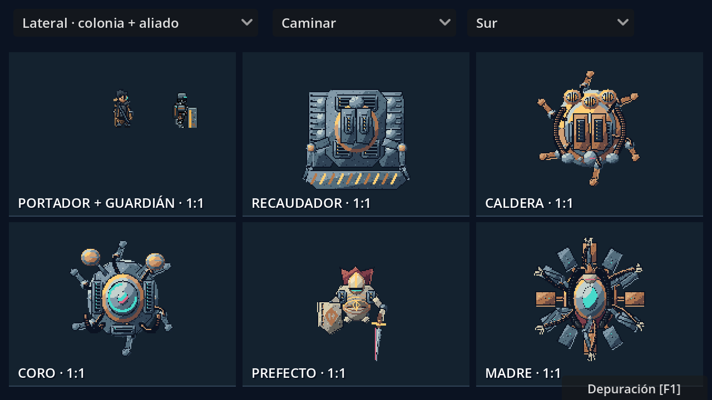

# Portador y cinco jefes en LibreSprite

## Cámara, identidad y escala

El Portador tiene **dos dibujos propios**: lateral para la colonia y cenital para las arenas. Se estudió su retrato real en la esquina inferior derecha de `assets/story/portraits_manga_v2.png`: cabello negro, rostro visible, abrigo marrón gastado, bufanda oscura, correas, colgante e implante cian pequeño. El sprite anterior llevaba casco y visor y no representaba ese diseño.

Su cuerpo lateral mide **35 píxeles**, frente a los 31 del guardián en reposo. Ambos se muestran a escala **1:1** y apoyan en el mismo suelo. El lienzo de 96 píxeles incluye margen transparente para armas y efectos.



Los jefes muestran cubiertas y volúmenes desde arriba: orugas y compuertas del Recaudador; tapa circular, chimeneas y tuberías de Caldera; disco sonar y antenas del Coro; hombros, casco, capa y armas del Prefecto; corona radial completa y seis brazos de cable de la Madre. Las direcciones cenitales se hornean en los fotogramas. La luz superior del sprite gira con la dirección horneada.


## Fuentes y animaciones

Los seis personajes tienen **siete variantes**, **256 fotogramas por variante**, **40 etiquetas por variante** y **1792 fotogramas en total**. Cada ASE contiene tres capas: cuerpo y apoyo, armas y mecanismos, efectos dibujados.

| Fuente en `assets/combat/native/sources/` | Lienzo | Anclaje | Cámara |
| --- | --- | --- | --- |
| `portador.ase` | 96 × 96 | 48, 73; pies | Lateral |
| `portador_cenital.ase` | 96 × 96 | 48, 48 | Cenital |
| `recaudador.ase` | 128 × 128 | 64, 64 | Cenital |
| `caldera.ase` | 128 × 128 | 64, 64 | Cenital |
| `coro.ase` | 128 × 128 | 64, 64 | Cenital |
| `prefecto.ase` | 160 × 160 | 80, 80 | Cenital |
| `madre.ase` | 128 × 128 | 64, 64 | Cenital |

Las etiquetas son `idle`, `walk`, `windup`, `attack`, `shoot`, `charge`, `exposed`, `hurt`, `death`, `dodge`, con sufijos `south`, `east`, `north`, `west`. Algunas sirven para previsualización y no son habilidades disponibles en la IA de todos los jefes.

La caminata avanza por distancia recorrida. El golpe tiene preparación, brazo y espada articulados y un único impacto; esquivar cancela un ataque en preparación. Las poses del jefe siguen su estado real. Las reglas de dificultad y las arenas se documentan en [Jefes, tácticas y arenas](JEFES_TACTICAS_Y_ARENAS.md).

## Ver y probar

1. Abre `levels/story/combat_animation_preview.tscn` y pulsa **F6**. Selecciona **Cenital · combate** o **Lateral · colonia + aliado**. Cambia dirección y secuencia. La galería utiliza la misma escala para todos.
2. En el juego, pulsa **F1 → Jefes → Entrar**. Muévete con WASD y ataca con J para comprobar el dibujo con la cámara real.
3. Abre los ASE con LibreSprite para editar capas, celdas y etiquetas.

Para abrir una mesa visible de trabajo en LibreSprite:

```powershell
python tools/live_combat_board.py
```

El editor muestra progresivamente una lámina con las siete variantes, un guardián real y el retrato manga del Portador. Cada ejecución crea un documento distinto en `.godot/live-art/` y conserva las fuentes editadas. La actualización utiliza la API de LibreSprite y revela filas del dibujo preparado; no es dibujo manual con ratón ni una transmisión continua de cada cambio del código. El retrato y el guardián se copian únicamente a la lámina de comparación, nunca a los nuevos sprites.

## Dibujar y exportar

`tools/libresprite_projection.js` contiene los diseños según la cámara y utiliza las primitivas de `tools/libresprite_combat.js`. Los píxeles, poses y exportaciones se producen en LibreSprite mediante JavaScript nativo. Python prepara los ASE vacíos, etiquetas y metadatos. No se usan imágenes generadas como entrada del renderizador de sprites.

Edita las celdas conservando dimensiones, orden y etiquetas. Exporta en filas de ocho columnas al PNG correspondiente. Para exportar una fuente editada:

```powershell
& 'D:/descargas/libresprite-development-windows-x86_64/libresprite.exe' --batch assets/combat/native/sources/portador.ase --sheet-type rows --sheet-width 768 --sheet assets/combat/native/portador.png
```

Para reconstruir desde el código de dibujo:

```powershell
python tools/build_combat_sprites.py
python tools/build_combat_sprites.py --actors portador portador_cenital prefecto
```

El constructor exige una marca de finalización y medidas del cuerpo por actor para detectar fallos del motor de scripts aunque el ejecutable termine con código 0. Las huellas en `provenance.json` protegen las fuentes editadas manualmente. `--overwrite-edits` reemplaza esos cambios de forma explícita. Exportar un ASE editado no requiere ese argumento.

## Validación

`tests/native_combat_art_test.gd`: **2167 comprobaciones**, sin recortes ni celdas vacías, al menos tres poses distintas por etiqueta, fuentes editables, cámaras, apoyo de pies, proporción con un aliado, galería a escala real, preparación del ataque, dirección, cancelación, daño y muerte. Se capturan la colonia y el combate para inspección visual con `-- --capture`. La batería general contiene **38 suites**. Cachés y registros quedan fuera de Git.

Referencias de la herramienta: [API oficial de scripts](https://github.com/LibreSprite/LibreSprite/blob/master/SCRIPTING.md), [opciones de exportación](https://github.com/LibreSprite/LibreSprite/blob/master/src/app/app_options.cpp) y [diferencias con Aseprite](https://github.com/LibreSprite/LibreSprite/issues/360).
