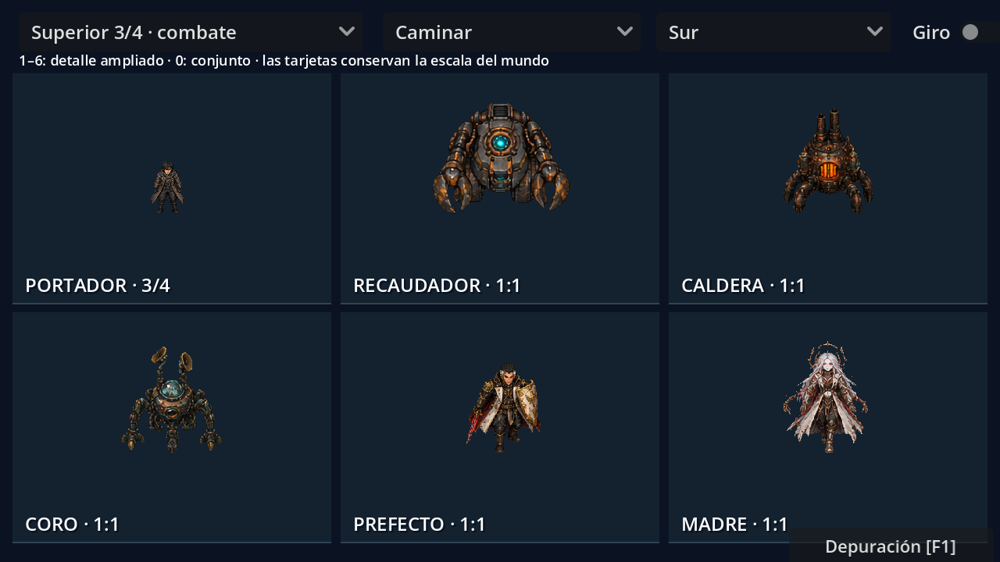
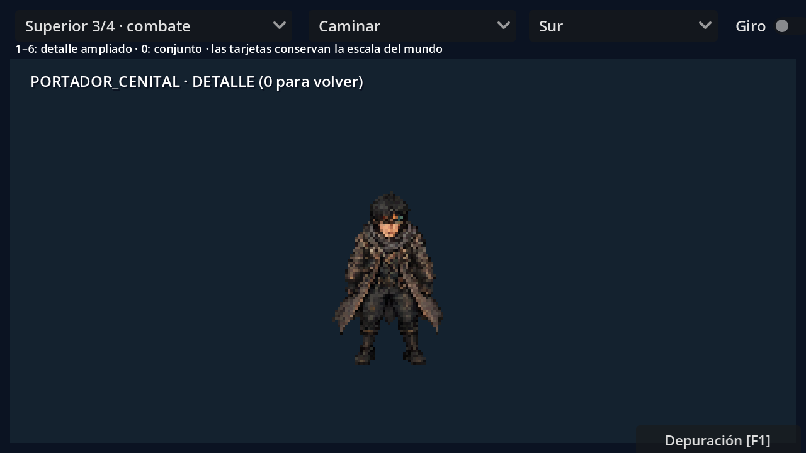

# Arte y animación de combate en LibreSprite

El juego utiliza ahora **poses ilustradas a partir de los retratos manga**, montadas y exportadas en LibreSprite. El Portador tiene versiones lateral y superior a tres cuartos; los cinco jefes tienen cuatro vistas propias. Las fuentes activas están en `assets/combat/illustrated/`.





## Probar

1. Abre `levels/story/combat_animation_preview.tscn` y pulsa **F6**.
2. Selecciona **Superior 3/4 · combate** o **Lateral · colonia + aliado** y una secuencia.
3. Activa **Giro** para revisar las cuatro vistas. Pulsa **1–6** para ampliar un personaje y **0** para volver al conjunto a escala de mundo.
4. Con **F5**, camina y esquiva en la colonia. En una arena, **J** muestra el golpe físico de espada. **F1 → Jefes → Entrar** permite practicar los cinco combates.

Las reglas de comandante se conservan: el Portador no recupera el daño contra tropas y portales de la colonia por cambiar su dibujo. Su secuencia lateral de ataque se puede revisar en la galería.

## Editar

Abre los siete `.ase` de `assets/combat/illustrated/sources/`. Sus capas son **Pose completa**, **Retoques** y **Luz y efectos**. Cuerpo y arma forman parte de cada pose pintada; los ajustes y efectos adicionales tienen capas propias.

Las hojas originales seleccionadas y sus prompts están en `assets/combat/illustrated/references/` y `assets/combat/illustrated/prompts.json`. La base visual se generó con la herramienta integrada `image_gen`; la separación de contornos, registro, muestreo, respiración secundaria, limpieza y exportación se ejecutan dentro de LibreSprite. Python realiza mediciones de lectura, prepara documentos vacíos y metadatos.

```powershell
python tools/build_illustrated_combat.py
python tools/live_combat_board.py --directions
```

El constructor se detiene si detecta retoques manuales posteriores en un ASE. Las fuentes y scripts procedurales anteriores se conservan en `assets/combat/native/` como referencia histórica; el juego carga las ilustradas.

La descripción completa del diseño, tamaños, poses, tiempos y referencias está en [Arte de combate ilustrado](ARTE_COMBATE_ILUSTRADO.md). Las mecánicas de los combates están en [Jefes, tácticas y arenas](JEFES_TACTICAS_Y_ARENAS.md).
