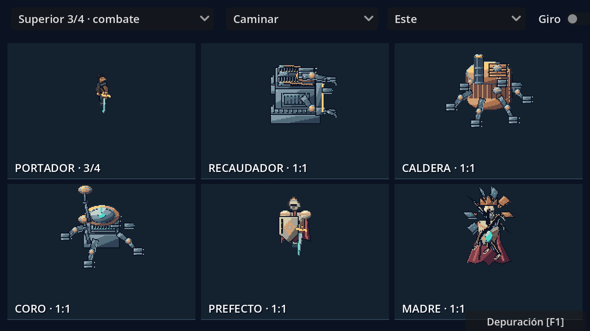
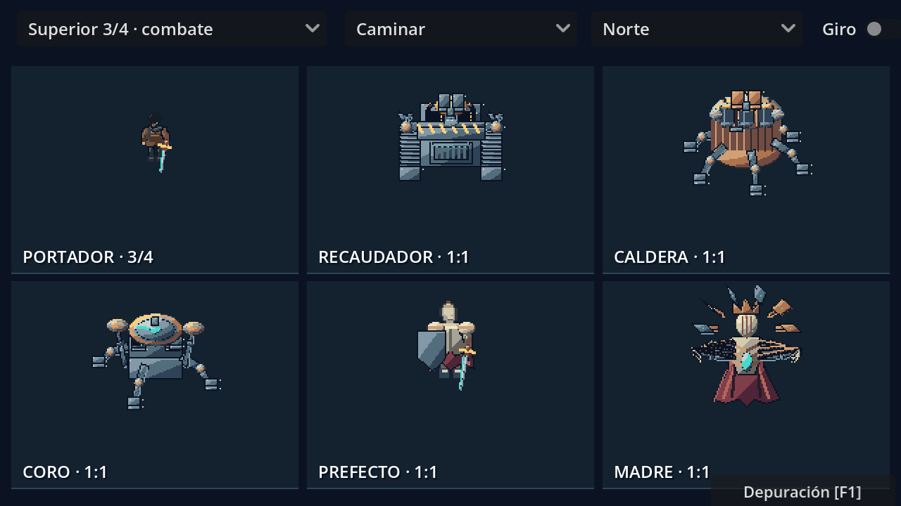

# Portador y cinco jefes en LibreSprite

## Cámara, identidad y escala

El Portador tiene **dos variantes**: lateral para la colonia y superior a tres cuartos para las arenas. Se estudió su retrato real en la esquina inferior derecha de `assets/story/portraits_manga_v2.png`: cabello negro, rostro visible, abrigo marrón gastado, bufanda oscura, correas, colgante e implante cian pequeño. Su anatomía utiliza cabeza, cuello, torso, brazos con mangas, manos de piel y piernas diferenciadas; se retiraron las articulaciones metálicas del cuerpo humano.

Su cuerpo lateral mide **35 píxeles**, frente a los 31 del guardián en reposo. Ambos se muestran a escala **1:1** y apoyan en el mismo suelo. El lienzo de 96 píxeles incluye margen transparente para armas y efectos.


La versión anterior giraba una imagen plana para obtener las direcciones; este y oeste estaban intercambiados y los humanoides quedaban tumbados. **Se eliminó esa transformación.** Frente, espalda y perfiles se dibujan por separado. Las cabezas permanecen arriba, las piernas abajo, y los ataques apuntan hacia su dirección. La iluminación se mantiene arriba a la izquierda de la pantalla.

En los jefes mecánicos se orientan las piezas en el plano del suelo y después se proyectan con una cámara fija a tres cuartos. La altura siempre sube en pantalla. Orugas, chasis, paneles, compuertas, patas, chimeneas, sonar y antenas muestran su volumen. Prefecto y Madre conservan una silueta erguida, con máscaras, espaldas y perfiles propios. Los detalles de mantenimiento sustituyen el ruido aleatorio de píxeles.






## Fuentes y animaciones

Los seis personajes tienen **siete variantes**, **256 fotogramas por variante**, **40 etiquetas por variante** y **1792 fotogramas en total**. Cada ASE contiene tres capas: cuerpo y apoyo, armas y mecanismos, efectos dibujados.

| Fuente en `assets/combat/native/sources/` | Lienzo | Anclaje | Cámara |
| --- | --- | --- | --- |
| `portador.ase` | 96 × 96 | 48, 73; pies | Lateral |
| `portador_cenital.ase` | 96 × 96 | 48, 61; pies | Superior 3/4 |
| `recaudador.ase` | 128 × 128 | 64, 84 | Superior 3/4 |
| `caldera.ase` | 128 × 128 | 64, 84 | Superior 3/4 |
| `coro.ase` | 128 × 128 | 64, 84 | Superior 3/4 |
| `prefecto.ase` | 160 × 160 | 80, 107; pies | Superior 3/4 |
| `madre.ase` | 128 × 128 | 64, 100; faldón | Superior 3/4 |

Las etiquetas son `idle`, `walk`, `windup`, `attack`, `shoot`, `charge`, `exposed`, `hurt`, `death`, `dodge`, con sufijos `south`, `east`, `north`, `west`. Algunas sirven para previsualización y no son habilidades disponibles en la IA de todos los jefes.

La caminata avanza por distancia recorrida. El golpe tiene preparación, brazo y espada articulados y un único impacto; esquivar cancela un ataque en preparación. Las poses del jefe siguen su estado real. Las reglas de dificultad y las arenas se documentan en [Jefes, tácticas y arenas](JEFES_TACTICAS_Y_ARENAS.md).

## Ver y probar

1. Abre `levels/story/combat_animation_preview.tscn` y pulsa **F6**. Selecciona **Superior 3/4 · combate** o **Lateral · colonia + aliado**. Cambia dirección y secuencia. Activa **Giro** para pasar automáticamente por las cuatro vistas. La galería utiliza la misma escala para todos.
2. En el juego, pulsa **F1 → Jefes → Entrar**. Muévete con WASD y ataca con J para comprobar el dibujo con la cámara real.
3. Abre los ASE con LibreSprite para editar capas, celdas y etiquetas.

Para abrir una mesa visible de trabajo en LibreSprite:

```powershell
python tools/live_combat_board.py
python tools/live_combat_board.py --directions
```

El editor muestra progresivamente una lámina con las siete variantes, un guardián real y el retrato manga del Portador. Con `--directions` muestra las cuatro vistas de los seis personajes: columnas sur, este, norte y oeste; filas Portador, Recaudador, Caldera, Coro, Prefecto y Madre. Cada ejecución crea un documento distinto en `.godot/live-art/` y conserva las fuentes editadas. La actualización utiliza la API de LibreSprite y revela filas del dibujo preparado; no es dibujo manual con ratón ni una transmisión continua de cada cambio del código. El retrato y el guardián se copian únicamente a la lámina de comparación, nunca a los nuevos sprites.

## Dibujar y exportar

`tools/libresprite_projection.js` contiene los diseños según la cámara y utiliza las primitivas de `tools/libresprite_combat.js`. Los píxeles, poses y exportaciones se producen en LibreSprite mediante JavaScript nativo. Python prepara los ASE vacíos, etiquetas y metadatos. No se usan imágenes generadas como entrada del renderizador de sprites.

Edita las celdas conservando dimensiones, orden y etiquetas. Exporta en filas de ocho columnas al PNG correspondiente. Para exportar una fuente editada:

```powershell
& 'D:/descargas/libresprite-development-windows-x86_64/libresprite.exe' --batch assets/combat/native/sources/portador.ase --sheet-type rows --sheet-width 768 --sheet assets/combat/native/portador.png
```

Para reconstruir desde el código de dibujo:

```powershell
python tools/build_combat_sprites.py
python tools/build_combat_sprites.py --actors portador portador_cenital prefecto
```

El constructor exige una marca de finalización y medidas del cuerpo por actor para detectar fallos del motor de scripts aunque el ejecutable termine con código 0. Las huellas en `provenance.json` protegen las fuentes editadas manualmente. `--overwrite-edits` reemplaza esos cambios de forma explícita. Exportar un ASE editado no requiere ese argumento.

## Validación

`tests/native_combat_art_test.gd`: **2220 comprobaciones**, incluyendo márgenes, poses distintas, fuentes, apoyo, proporción con un aliado, galería, ataques, daño y muerte. Las nuevas regresiones verifican las cuatro orientaciones, cabeza sobre pies, frente mecánico correcto, cabello en la parte superior del PNG real en todas las vistas, siluetas dentro de sus tarjetas y la opción Giro. Se capturan las cuatro direcciones, colonia y combate con `-- --capture`. La batería general contiene **38 suites**. Estas pruebas verifican integración y errores de orientación; la calidad artística se revisa también mediante las capturas. Cachés y registros quedan fuera de Git.

Referencias artísticas estudiadas: [SLYNYRD, Top Down Character Sprites](https://www.slynyrd.com/blog/2019/10/21/pixelblog-22-top-down-character-sprites), [Top Down Character Animation](https://www.slynyrd.com/blog/2025/3/24/pixelblog-55-top-down-character-animation) y [Human Walk Cycle](https://www.slynyrd.com/blog/2024/5/24/pixelblog-50-human-walk-cycle). Se aplicaron la construcción de vistas independientes, la comparación de proporciones, las poses de contacto y paso, y la separación entre anatomía y detalles. Sus dibujos no se incorporaron a los sprites del proyecto.

Referencias de la herramienta: [API oficial de scripts](https://github.com/LibreSprite/LibreSprite/blob/master/SCRIPTING.md), [opciones de exportación](https://github.com/LibreSprite/LibreSprite/blob/master/src/app/app_options.cpp) y [diferencias con Aseprite](https://github.com/LibreSprite/LibreSprite/issues/360).
