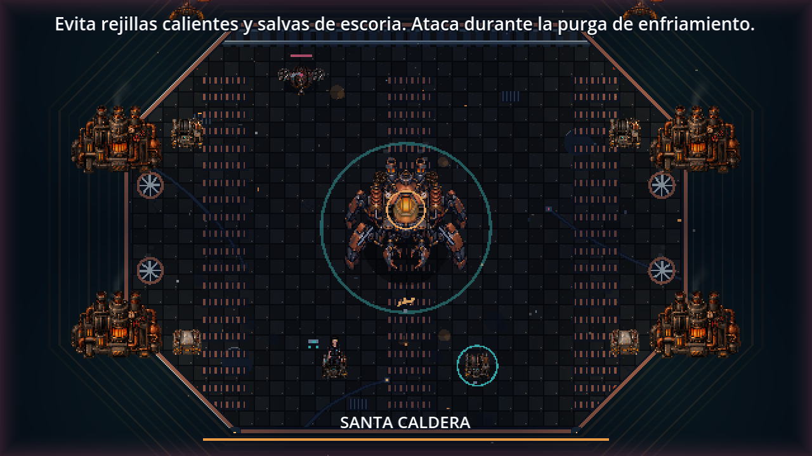
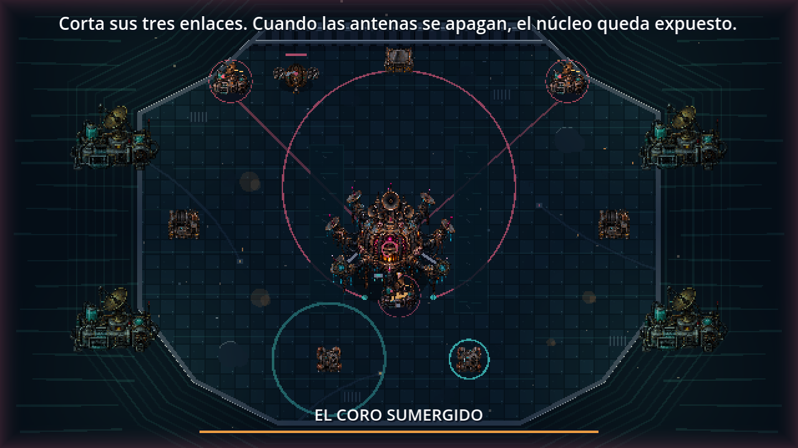
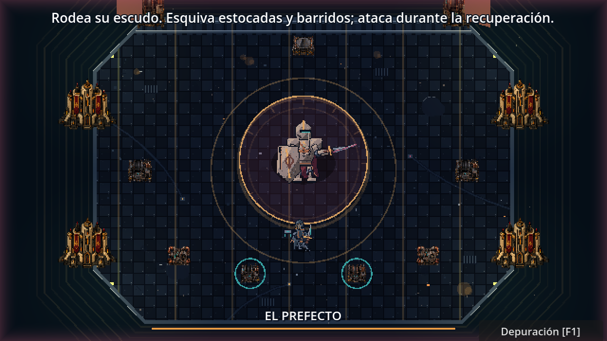
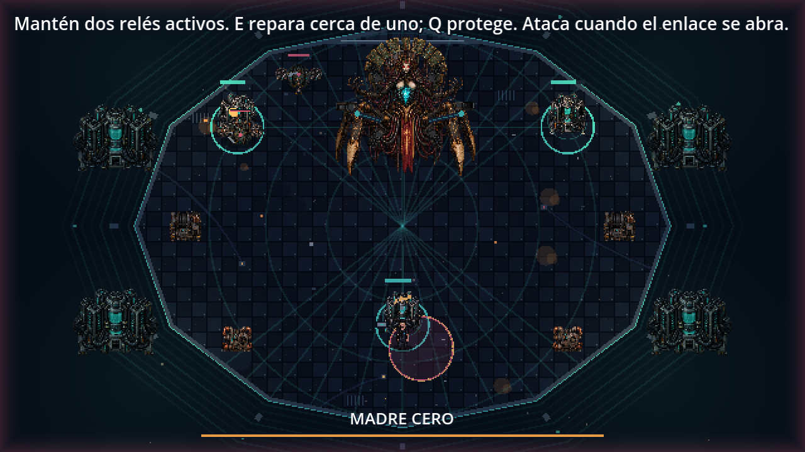

# Cinco jefes: decisiones, terreno y escoltas

## Probar en Godot

Abre una de estas escenas y pulsa **F6**. No modifica tu checkpoint de campaña.

| Escena en `levels/expedition/` | Jefe | Respuesta táctica y terreno |
| --- | --- | --- |
| `recaudador_arena.tscn` | Recaudador | Elige garra cerca, salvas con línea de tiro y embestida a distancia o contra jugadores que se cubren. **E** en una consola suelta la carga sobre el centro marcado: atrae al jefe y sal del círculo. |
| `caldera_arena.tscn` | Santa Caldera | Escoge entre calor, arremetida y salvas según movimiento y distancia. Orienta las rejillas para cortar la trayectoria. **E** en una consola durante el aviso o calor cancela las rejillas y provoca una purga vulnerable de tres segundos. |
| `choir_arena.tscn` | Coro Sumergido | Se desplaza para defender la antena amenazada; marcas anticipan tu trayectoria. Ondas conservan su origen al moverse el jefe y dejan una abertura cian. Dos canales ralentizan al caminar; **E** silencia ondas y corriente durante cinco segundos. Rompe las tres antenas para exponer el núcleo. |
| `prefect_arena.tscn` | El Prefecto | Rodea, elige salva a distancia, estocada al aproximarse o barrido cerca. El barrido tiene frente y permite escapar por detrás. Su combo termina tras dos estocadas, corrigiendo el reinicio infinito anterior. **E** levanta durante cinco segundos un parapeto físico contra proyectiles y estocadas. |
| `mother_arena.tscn` | Madre Cero | Prioriza relés débiles o alejados del Portador; recuerda objetivos recientes. Sus saboteadores atacan infraestructura. Mantén dos relés activos; **E** repara uno cercano y **Q** los protege también contra sabotaje. |

Movimiento: WASD/flechas. **J** ataca; **Espacio** esquiva. Los módulos automáticos también ayudan contra escoltas. Los mecanismos de las primeras cuatro arenas están en las dos consolas con aro cian de la parte baja. Tienen 20 segundos de enfriamiento independiente. La carga central también puede herirte: no permanezcas debajo.

## Decisiones y navegación

`systems/boss_tactics.gd` incorpora percepción cada 0,16 segundos, velocidad observada suavizada, anticipación máxima de 0,4 segundos, enfriamientos por acción y memoria de las últimas tres decisiones. No lee las teclas del jugador. Los avisos de embestidas y escoltas fijan su dirección; el jugador puede cambiar de trayectoria después.

La elección evalúa utilidad contextual; no es una lista aleatoria de ataques. Cada jefe conserva su máquina de estados para que avisos, daño y recuperación sigan siendo explícitos. El Coro conserva un ritmo de pulsos reconocible y Madre Cero su objetivo de infraestructura, mientras sus desplazamientos y objetivos reaccionan a la situación.

La navegación usa **AStarGrid2D nativo**, con los vértices reales de cada arena y coberturas infladas según el tamaño del personaje. Recalcula rutas cada 0,35 segundos o cuando el objetivo se desplaza bastante. Las embestidas conservan colisiones físicas y no siguen rutas curvas. El parapeto temporal del Prefecto las detiene durante su duración.

## Refuerzos y justicia

- Recaudador y Caldera: artilleros voladores que se desplazan, fijan una línea de disparo durante 0,95 segundos y disparan una vez antes de recuperarse.
- Coro y Prefecto: cazadores de alcance corto con barrido anunciado; no dañan por contacto.
- Madre Cero: saboteadores que buscan un relé activo cercano y lo dañan después del aviso. Q bloquea ese daño.
- Llegadas marcadas durante 1,4 segundos, lejos del jugador. Máximo dos escoltas simultáneas; tres en Madre Cero, incluyendo avisos pendientes. Los primeros cuatro jefes las convocan en segunda fase; Madre Cero desde la primera.
- No entran refuerzos durante ventanas de núcleo expuesto. Intervalos de 22–28 segundos y retirada tras 32 segundos de vida. No hay crecimiento ilimitado de enemigos.
- Espada y módulos pueden eliminarlos; derrotar uno devuelve ocho puntos de resistencia una sola vez. Sin recompensas de salud infinitas.
- Pausa y final del encuentro detienen o eliminan llegadas, escoltas, carga y parapeto.

Se conservan vida y multiplicadores previos de los cinco jefes. La dificultad aumenta mediante decisiones y presión combinada. Las pruebas verifican funcionamiento y límites; el ajuste fino del reto requiere partidas humanas con distintos equipos.

## Arte y presentación

| Fundición | Barrio inundado |
| --- | --- |
|  |  |

| Ciudadela | Núcleo de la red |
| --- | --- |
|  |  |

`assets/expedition/arena/encounter_machines_v1.png` es un atlas original RGBA de 1536 × 1024: intercambiador de fundición, bombeo/sonar, columna corporativa y núcleo de servidores. Se generó mediante la herramienta nativa de imágenes y se copió al proyecto sin alterar sus píxeles. `tools/art/measure_art.py` solo lee alfa y escribe metadatos de recorte; nunca modifica imágenes. Las regiones separan las cuatro máquinas y excluyen margen transparente.

Cada recinto usa su maquinaria, paleta, señales y movimiento: vapor y válvulas, corrientes y sonar, paños corporativos o pulsos de datos. Las coberturas y los relés sustituyen las figuras grises antiguas por sprites detallados. El Coro tiene un perímetro nuevo de doce vértices. **Los actores actuales utilizan secuencias completas dibujadas y exportadas desde LibreSprite**, con cuerpo, armas y efectos por capas; las ilustraciones anteriores quedan como alternativa del Inspector. [Fuentes, dimensiones y galería](COMBATE_LIBRESPRITE.md).

Los avisos superiores y nombres de jefe usan una fuente de lectura mayor; el texto de mecanismo usa contorno oscuro. Efectos de ambiente respetan pausa y la preferencia de partículas; no se añaden flashes intensos.

Especificación para futuros recursos: maquinaria original industrial, acero azul oscuro, cobre oxidado, ámbar y cian contenidos; vista elevada consistente, contorno selectivo, tornillos, rejillas, tuberías y desgaste; silueta clara al reducir, apoyo físico visible, fondo alfa real. Variantes de cada distrito deben compartir materiales y escala. Las nuevas fuentes de LibreSprite ya separan cuerpo, armas/mecanismos y efectos en capas editables.

## Herramientas investigadas

La búsqueda en el catálogo de plugins no devolvió una integración pertinente de Godot entre sus resultados. Se revisaron las fuentes oficiales de [Beehave](https://github.com/bitbrain/beehave) y [LimboAI](https://github.com/limbonaut/limboai): ambos ofrecen árboles de comportamiento; LimboAI también máquinas de estados. Ninguno añade decisiones de combate por sí solo. Para estos cinco actores se eligió una capa pequeña de utilidad sobre los estados existentes y [AStarGrid2D de Godot](https://docs.godotengine.org/en/stable/classes/class_astargrid2d.html), evitando añadir una dependencia que no se utilizara realmente. No se instalaron esos plugins ni se requiere conexión a una IA externa durante el juego.

## Validación

`tests/boss_tactics_test.gd` pasa **118 comprobaciones** sobre decisiones contextuales, memoria, límites de anticipación, navegación física alrededor de un pilar, llegadas, daño manual y automático, recompensas únicas, mecanismos, corriente, abertura de ondas, sabotaje, pausa y limpieza. `--capture` guarda capturas de los cinco recintos en `.godot/tactics/`. Se incorpora a las **38 suites** de `tests/run_all.gd`, junto a las pruebas existentes de campaña, jefes y progresión. Los registros y las capturas de validación no se incluyen en Git; las imágenes seleccionadas en `docs/media/` documentan el estado del juego.

```powershell
godot --headless --path . --script res://tests/boss_tactics_test.gd
godot --headless --path . --script res://tests/run_all.gd
```

En Windows usa el ejecutable de consola y un APPDATA de validación separado para conservar tu partida.
