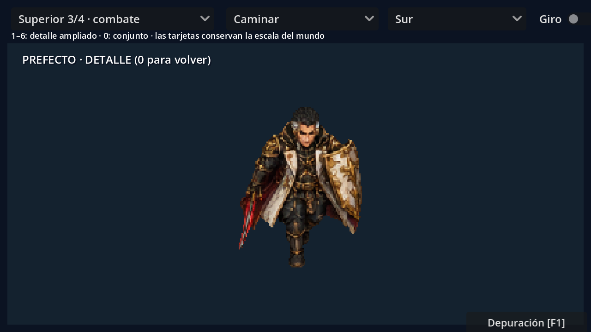
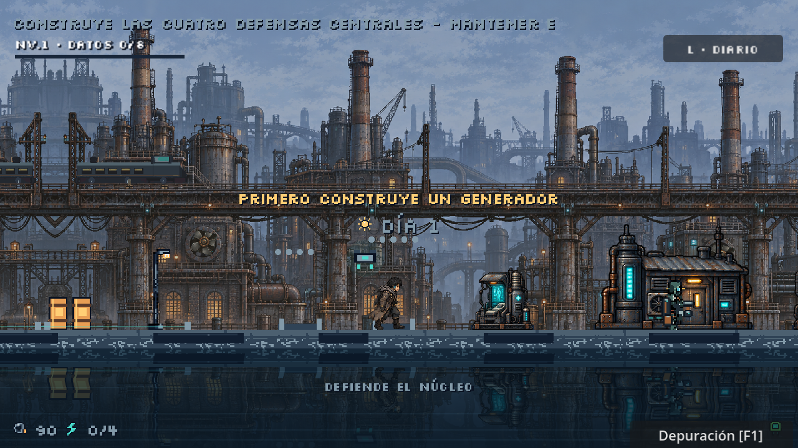

# Portador y jefes: arte y animaciones actuales

## Recursos activos

`components/combat_sprite_library.gd` carga `assets/characters/combat/layout.json`: textura, celda, ancla, escala y secuencias. `CombatFlipbook` reproduce fotogramas completos y elige pose por movimiento, ataque, daño, esquiva o muerte. Los archivos ASE originales y los PNG activos no siempre son equivalentes.

| Variante | Celda del PNG activo | Escala de dibujo | Fuente actual |
| --- | --- | --- | --- |
| Portador lateral | 192 × 192 | 0,5 | Base ilustrada y clips de `sources/pixellab_portador/` |
| Portador cenital | 192 × 192 | 0,5 | Base ilustrada y montaje LibreSprite |
| Recaudador, Caldera y Coro | 320 × 320 | 0,65 | Montaje ilustrado LibreSprite |
| Prefecto y Madre Cero | 144 × 144 | 1,3333 | Poses pintadas y clips de PixelLab integrados con Python |

El manifiesto mantiene 40 secuencias base y 256 índices de fotograma por variante. Las siete fuentes ASE originales contienen 256 fotogramas cada una; `provenance.json` registra 416 poses de entrada originales, reutilizadas con pausas. Eso no significa 1792 dibujos independientes. Las fuentes ASE de Prefecto y Madre conservan lienzos de 320 px, aunque sus PNG activos usan 144 px.





## Identidad y movimiento

Los retratos y pinturas de referencia conservan las identidades del Portador, Prefecto, Madre y los tres autómatas. Consultar `assets/characters/combat/prompts.json` y `references/` antes de solicitar variantes; no reemplazar la ropa, rostro o equipo por un maestro antiguo de 48 px.

El Portador lateral integra reposo, marcha, ataque, esquiva, daño y caída desde `sources/pixellab_portador/`. La carrera tiene una hoja adicional, `portador_correr.png`, que `CombatSpriteLibrary` añade como `run_east` y `run_west`. El oeste se obtiene por espejo en ese integrador. El Portador cenital conserva sus cuatro vistas del montaje base.

Prefecto y Madre usan poses pintadas y clips de PixelLab disponibles en `sources/pixellab_prefecto/` y `sources/pixellab_madre/`. Los clips laterales se reflejan para oeste; las vistas sin clip generado reutilizan poses pintadas. La caída de ambos se orienta a un perfil en `CombatFlipbook`. No describir sus PNG actuales como una malla articulada exportada directamente del ASE.

La cadencia de marcha sigue la distancia recorrida: 64 unidades por ciclo para Portador lateral, 56 para cenital, 76 para Prefecto y 92 para Madre. La carrera lateral usa 96. Las poses de preparación y golpe siguen `Player.ATTACK_ANIM_DURATION` (0,3 s), con el impacto tras el primer cuarto de la animación. Las animaciones representan el combate; el daño se decide en los controladores.

## Reconstrucción y precauciones de edición

`tools/art/build_illustrated_combat.py` mide alfa y prepara el montaje base; `libresprite_illustrated_combat.js` registra poses y exporta ASE/PNG. El generador comprueba hashes de fuentes para proteger ediciones; `--overwrite-edits` permite reemplazarlas explícitamente. Ese montaje base no incorpora por sí solo las integraciones posteriores de PixelLab.

`tools/art/integrar_portador_pixellab.py` compone el PNG lateral y la hoja de carrera a partir de los clips guardados. `tools/art/integrar_jefes_pixellab.py` compone Prefecto y Madre, reduce sus celdas a 144 px y actualiza el manifiesto. Ambos escriben los PNG directamente mediante Pillow; no actualizan los ASE originales. Los originales, clips y scripts son entradas necesarias, no respaldos inútiles.

Los comandos siguientes reconstruyen recursos y pueden reemplazar PNG/manifiesto; no son necesarios para jugar:

```powershell
python tools/art/build_illustrated_combat.py --help
python tools/art/integrar_portador_pixellab.py
python tools/art/integrar_jefes_pixellab.py
```

No exportar un ASE antiguo sobre los PNG actuales del Portador lateral, Prefecto o Madre esperando conservar los clips posteriores. Las copias de marcha en `sources/walking/` son extraídas de los ASE, no de esos PNG activos. [Guía de copias de marcha](../../assets/characters/combat/sources/walking/README.md).

## Probar

F6 en `levels/story/combat_animation_preview.tscn`: cambiar secuencia, cámara y orientación; Giro recorre vistas, **1–6** abre detalle y **0** vuelve al conjunto. F5 permite ver marcha/carrera lateral; F1 en editor/depuración abre los cinco jefes.

Validar con `tools/maintenance/validate.ps1`. `native_combat_art_test`, `boss_pressure_test` y `boss_melee_test` están entre las 67 ejecuciones de `tests/run_all.gd`. Las pruebas de datos y geometría no sustituyen revisar continuidad visual en una ventana.

[Guía de arte](../GUIA_ARTE.md) · [Presión de jefes](../gameplay/EFECTOS_Y_PRESION_JEFES.md) · [Procedencia](ASSET_SOURCES.csv).
