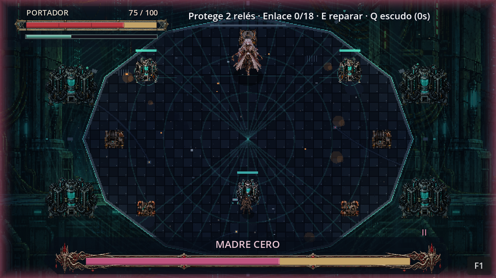

# Interfaz de vida en las arenas

El Portador muestra su vida roja, valor numérico y resistencia verde arriba a la izquierda. Su medallón representa la llave neuronal. La vida del jefe ocupa una barra inferior de mayor grosor, con nombre, fase, marco biselado y emblema propio.

La franja dorada muestra el daño reciente: la vida real cambia inmediatamente, la estela espera 0,55 segundos para el jugador y 0,65 para el jefe, y después desciende hasta el valor actual. Curarse o restaurar valores desde F1 actualiza las barras. La animación se detiene durante la pausa y las conversaciones.

| Encuentro | Marco y emblema |
| --- | --- |
| Recaudador | Cobre envejecido, engranaje y reactor cian |
| Santa Caldera | Cobre caliente, aletas de disipación y hogar encendido |
| Coro Sumergido | Metal azul, marcas de sonar y resonador |
| Prefecto | Marfil y latón, escudo con espada |
| Madre Cero | Plata rosada, filigrana de cables y corona neuronal |

Un borde cian señala la ventana vulnerable del jefe. Los avisos tácticos permanecen arriba a la derecha. El botón de depuración se compacta a **F1** en las arenas para dejar libre el marco inferior.

La composición se inspira en la lectura de vida de Dark Souls; los marcos y símbolos son originales del proyecto, dibujados en Godot para su interfaz industrial. Se consultó la [galería oficial de Dark Souls Remastered](https://www.darksouls.jp/remastered/movieandimages.html); no se copiaron sus recursos gráficos.

## Probar

Ejecuta F5, abre F1 y entra en cualquiera de los cinco jefes. Recibe un golpe, esquiva para consumir resistencia y daña al jefe. Compara las fases y abre el núcleo. Pausa durante una estela para comprobar que se congela.

`tests/boss_hud_test.gd` comprueba 66 condiciones: daño real inmediato, retención y descenso de las estelas, pausa, curación, resistencia, fase, vulnerabilidad, cinco paletas y separación del botón F1. Con `-- --capture` guarda cinco capturas en `.godot/combat-art/`. La batería completa contiene 40 suites.

El error de carga de `CoroSumergido` se resolvió retirando un espacio situado antes de las tabulaciones de su línea 109; no requería cambiar sus mecánicas.
