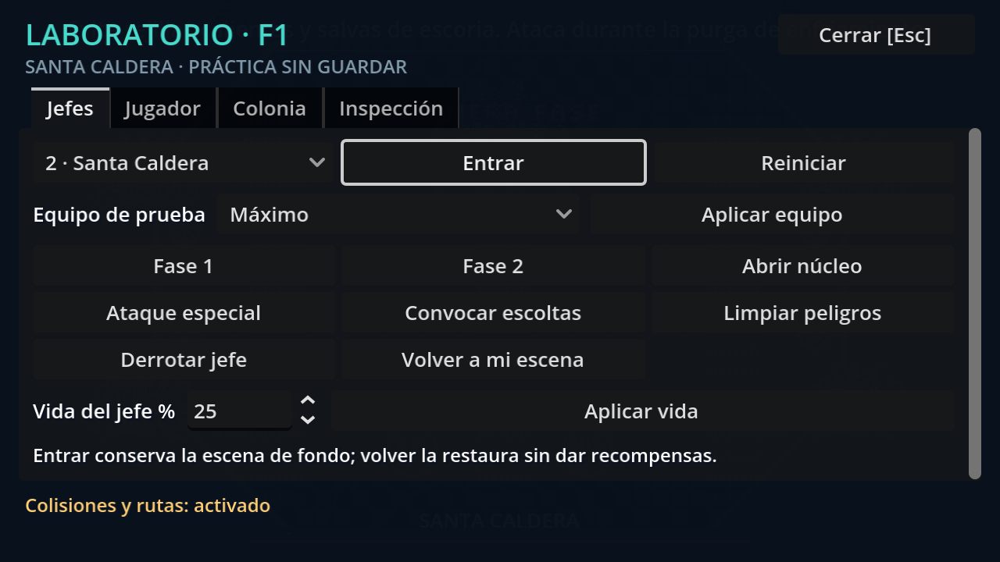

# Laboratorio de depuración

**Pulsa F1**, desde el menú, una colonia o un jefe. También puedes pulsar el botón **Depuración [F1]** de la esquina inferior derecha. **Esc o F1** cierra el panel. La letra es de lectura normal, más grande que la tipografía pixelada del HUD.



## Probar cualquier jefe

En **Jefes**, elige uno de los cinco y pulsa **Entrar**. Puedes hacerlo sin construir la colonia ni llegar al tren. El combate comienza con vida y resistencia completas. **Conservar equipo** copia armas, pasivas, daño neuronal y rango de dron del personaje actual; desde el menú utiliza el equipo inicial. También hay conjuntos **Inicial, Intermedio y Máximo**.

**F1 → Volver a mi escena** restaura la colonia, arena o menú que estaba detrás, incluyendo su pausa, interfaz y audio. El combate de práctica no da recompensas ni avanza la campaña. Reiniciar crea un encuentro nuevo del mismo jefe. Las ayudas activadas dentro de esa prueba se restauran a sus valores anteriores al volver.

Controles de jefe:

- Fase 1 o 2; porcentaje de vida entre 1 y 100.
- Abrir el núcleo respetando el mecanismo de vulnerabilidad de cada jefe.
- Preparar su ataque especial y convocar escoltas con los límites normales.
- Limpiar proyectiles, marcas y refuerzos. Conserva las antenas del Coro para evitar bloquear el combate.
- Derrotarlo para comprobar su final, o reiniciarlo después de una derrota.

## Ayudas de jugador

| Atajo | Herramienta |
| --- | --- |
| F1 | Abrir/cerrar laboratorio |
| F2 | Invulnerabilidad del Portador |
| F3 | Congelar/descongelar IA enemiga |
| F4 | Mostrar colisiones, rutas y estado del jefe |

La página **Jugador** añade resistencia infinita, protección del núcleo, congelación del reloj de colonia, curación/reparación, daño editable de hoja y velocidad **0,25× / 0,5× / 1× / 1,5× / 2×**. El botón de restablecer desactiva las ayudas y vuelve a velocidad normal.

F3 detiene el jefe y las escoltas, o los enemigos de la colonia. Los proyectiles y mecanismos continúan: usa pausa, cámara lenta o limpiar peligros para observarlos. F4 no cambia el combate ni desactiva el guardado.

## Probar la colonia

**Nueva colonia de práctica** abre uno de los cinco distritos desde cero. Cambia de escena; para visitar solo un jefe y conservar tu escena en memoria usa **Entrar** en la página Jefes.

En **Colonia** puedes añadir 500 de chatarra o 100 de experiencia, completar edificios, elegir el nivel 1–3 del núcleo y defensas, seleccionar el número de día e iniciar una oleada nocturna, preparar operaciones/portales/tren, añadir aliados y civiles, crear hasta diez enemigos por pulsación, retirarlos o teletransportarte al núcleo, taller, frentes o estación. Los aliados profesionales requieren su edificio construido y una plaza libre.

La experiencia abre las elecciones reales al cerrar el panel. Los enemigos creados conservan su tipo, animaciones y comportamiento normales. Completar edificios prepara base de nivel 3 y servicios; **Nivel de estructuras** permite probar diseños y salud de los tres niveles.

## Guardado y alcance

Abrir o cerrar F1 no interviene la colonia. Al aplicar un truco que modifica una colonia, esta queda marcada **PRÁCTICA SIN GUARDAR**: su persistencia se desconecta antes del cambio. Desactivar ayudas no reactiva el guardado de esa sesión. Para recuperar tu campaña, vuelve al menú y usa **Continuar**; se conserva el último checkpoint normal.

Las nuevas colonias de práctica se identifican antes de inicializar la persistencia: no cargan, archivan ni sobrescriben la partida normal. Las arenas de práctica mantienen suspendida la escena original. Las ayudas no forman parte del formato de guardado ni de las opciones persistentes del usuario.

El laboratorio se habilita en Godot y compilaciones de depuración. En una exportación de producción queda desactivado por defecto; puede habilitarse explícitamente al iniciar con `-- --debug-tools`.

## Informes y capturas

**Inspección** muestra FPS, velocidad, vida, fase, estado, decisión y memoria reciente del jefe, escoltas y datos de colonia. **Guardar informe JSON** escribe `user://debug/informe.json`. **Captura sin panel** guarda un PNG en `user://debug/`. El aviso inferior indica la ruta completa; son archivos locales del usuario, fuera del repositorio. Las capturas requieren una ventana gráfica.

## Archivos y pruebas

`systems/game_debug.gd` es el autoload `DebugTools`; `ui/debug_panel.gd` construye las cuatro páginas y `ui/debug_geometry.gd` dibuja geometría de depuración en las coordenadas de la cámara. Las comprobaciones de entrada modal impiden que Esc cierre también una novela, opciones o pausa que estuvieran debajo.

`tests/debug_tools_test.gd` verifica **113 comprobaciones**: entrada de teclado real, pausa, los cinco jefes, retorno y audio, vulnerabilidad, conjuntos de equipo, conservación de mejoras neuronales, recursos, edificios, niveles, creación de unidades, protección byte a byte del checkpoint, informes y apertura de una colonia nueva. Incluida en las **40 suites** de `tests/run_all.gd`.

```powershell
godot --headless --path . --script res://tests/debug_tools_test.gd
godot --path . --script res://tests/debug_tools_test.gd -- --capture
```

Usa un perfil APPDATA de validación separado de tu partida. Las capturas automáticas se guardan en `.godot/debug/` y no se incluyen en Git; la captura seleccionada de esta guía documenta la herramienta.
